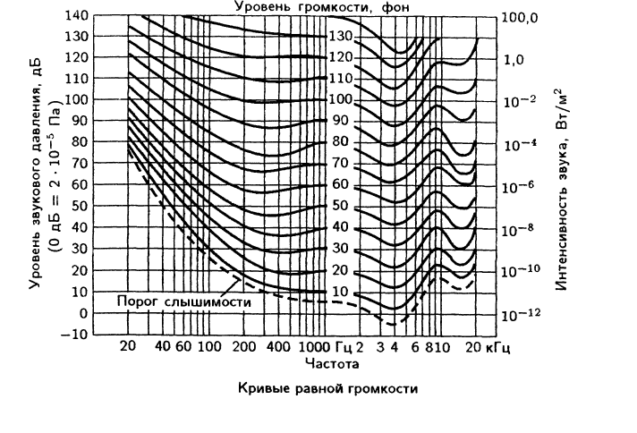
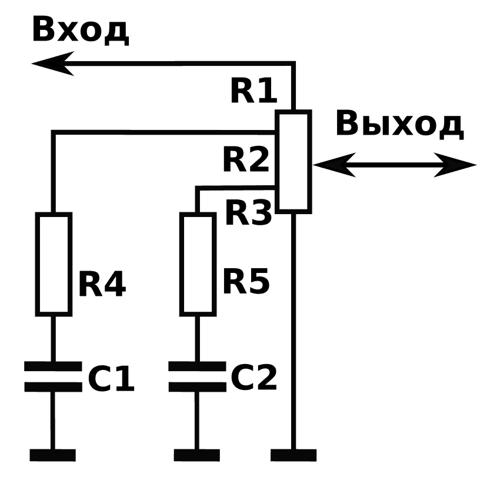
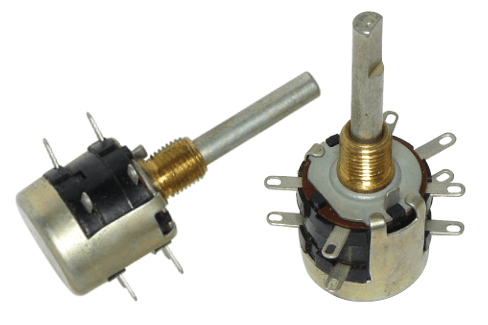
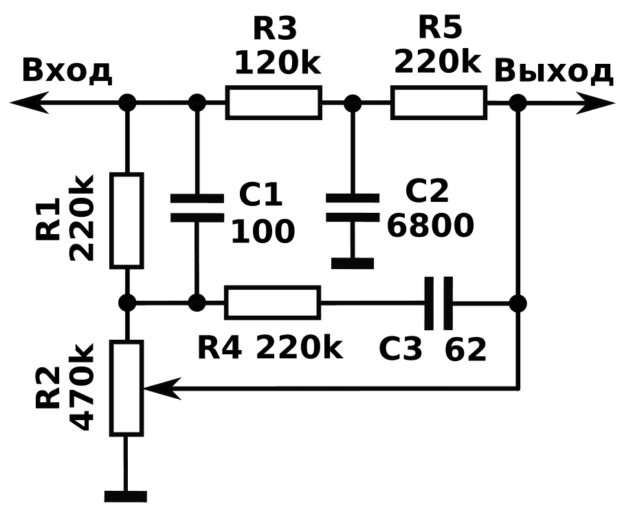

[Русский](./README.ru.md) | **English**

# What a loudness-compensated volume control is, with example circuits

**Category:** Audio circuit design  
**Original:** https://audiogeek.ru/tonkompens-regulyator-gromkosti/

---

Our hearing is such that as the volume is lowered we hear the edges of the audio range, i.e. high and low frequencies, worse and worse. High frequencies are not so bad, but at low frequencies a fairly significant boost is required as the volume goes down. A loudness-compensated volume control is used to solve this problem.

As proof, the following figure shows the equal-loudness contours of the human ear:

The loudness-compensated volume control mentioned above changes the shape of the frequency response at the same time as the volume, so that the timbre of the sound depends only weakly on the volume level. For the compensation to be correct and the volume change to be even, a given position of the control must produce a corresponding loudness level at the listening point. So with the volume control at maximum, a loudness level of 90 phon should be obtained at the listening point.

Simple loudness-compensated volume controls create a relative boost of the lowest frequencies, which is greater the lower the volume. There are also more complex circuits, **with** and **without** active elements (transistors, op-amps), that create a relative boost of both low and high audio frequencies.

## **A loudness-compensated volume control with a tapped potentiometer**

The simplicity of this circuit is offset by the problem of finding a taper-B variable resistor with two taps.

If you did manage to find the right resistor, the other elements can be calculated from its resistance:

> - **R3** = **R** / 1.2
> - **R1** = **R2** = 0.1 • **R3**
> - **R4** = 0.11 • **R1**
> - **R5** = 0.125 • **R1**
> - **C1** = 4 / **R1**
> - **C2** = 3.9 / **R1**
> - Where **R** is the resistance of the variable resistor, kΩ
> - **R1**, **R2**, **R3** are the resistances of the sections of the variable resistor, kΩ
> - **R4**, **R5** are the resistances of the resistors of the correcting networks, kΩ
> - **C1**, **C2** are the capacitances of the correcting networks, µF

Here is one version of a tapped variable resistor of domestic (Russian) manufacture:

## **A loudness-compensated volume control with a potentiometer without taps**

Such a control can also be built with a variable resistor available to anyone, **without extra taps**. The circuit of this control is shown in the next figure.

Using a resistor without taps means additional parts are needed, but this does not complicate the circuit much.

Both circuits give a relative boost only in the low audio frequencies. It is relative because the absence of active elements does not allow a boost above the original signal; instead the rest of the signal is attenuated. This principle underlies any passive audio filter.

The second circuit was built and tested. The elements of the correcting networks were soldered directly to the terminals of a dual variable resistor. Such passive controls are best placed after the preamp stage and before the output stages.

Listening in various conditions demonstrated the effectiveness of this circuit, and its use turned out to be sufficient for home use at low volume levels. A loudness-compensated volume control lets you preserve the tonal balance of a recording without losing the bass.

## **Instead of a conclusion...**

I would like to add that the endless arguments on audiophile forums about the rightness or wrongness of using loudness-correcting networks often run against the general ideology of Hi-End, whose essence is above all music reproduction as close to reality as possible, where deviations from the original that the ear can detect disappear.

For correct perception of a musical program it is necessary to create **[the required sound pressure level](../kakaya-moshnost-realno-nujna-dlya-doma/)** during playback, which your neighbors will clearly not be happy about. So a loudness-compensated volume control can be seen as a successful compromise for preserving the correct tonal color of music at home.

*Originally written for [AudioGeek.ru](https://github.com/SkyTrip-13/AudioGeek). Translated from Russian.*
