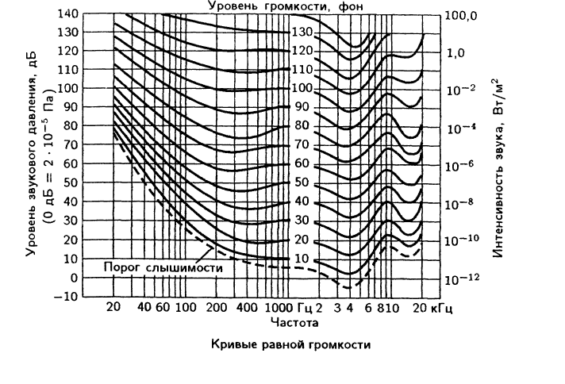
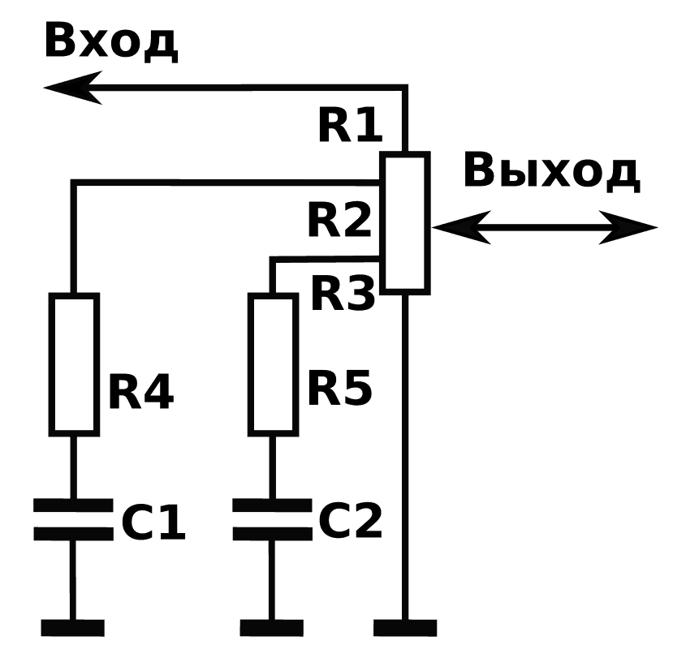
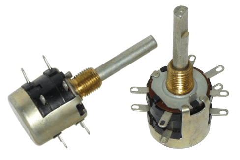
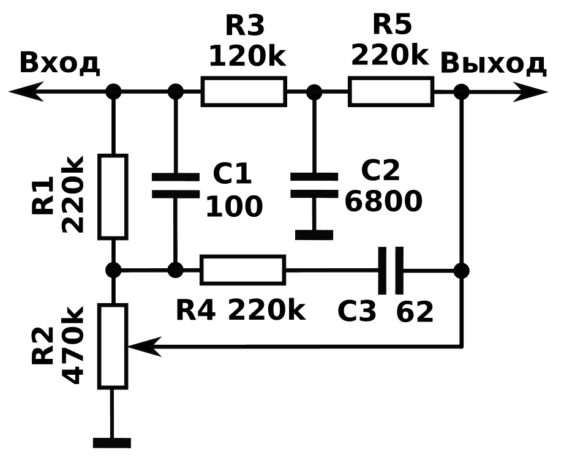

[English](./README.md) | **Русский**

# Что такое тонкомпенсированный регулятор громкости, примеры схем

**Рубрики:** Схемотехника аудиотракта  
**Оригинал:** https://audiogeek.ru/tonkompens-regulyator-gromkosti/

---

Особенности нашего слуха таковы, что при снижении громкости мы все хуже и хуже начинаем слышать края звукового диапазона, т.е. высокие и низкие частоты. Если с высокими частотами все не так уж и плохо, то вот на низких частотах со снижением громкости требуется их довольно значительный подъем. Для решения данной проблемы применяется тонкомпенсированный регулятор громкости.

В доказательство сказанному на следующем рисунке представлены кривые равной громкости человеческого уха:

Упомянутый выше тонкомпенсированный регулятор громкости одновременно с изменением громкости изменяет и форму АЧХ так, чтобы тембр звука слабо зависел от уровня громкости. Для того, чтобы тонкомпенсация была верной, а изменение громкости равномерным, необходимо, чтобы определенное положение регулятора создавало в точке прослушивания соответствующий уровень громкости. Так, при установке регулятора громкости в положение максимальной громкости в точке прослушивания должен быть получен уровень громкости в 90 фон.

Простые тонкомпенсированные регуляторы громкости создают относительный подъем низших частот, который тем больше, чем меньше громкость. Существуют также и более сложные схемы, **с** и **без** использования активных элементов (транзисторы, ОУ), которые создают относительный подъем как низких, так и высоких звуковых частот.

## **Тонкомпесированный регулятор громкости на резисторе с дополнительными отводами**

Простота этой схемы компенсируется проблемой поиска переменного резистора группы В с двумя отводами.

Если же вам удалось найти нужный резистор, то на основании величины сопротивления этого резистора можно рассчитать и остальные элементы:.

> - **R3** = **R** / 1.2
> - **R1** = **R2** = 0.1 • **R3**
> - **R4** = 0.11 • **R1**
> - **R5** = 0.125 • **R1**
> - **C1** = 4 / **R1**
> - **C2** = 3.9 / **R1**
> - Где **R** - сопротивление переменного резистора, кОм
> - **R1**, **R2**, **R3** - сопротивление секций переменного резистора, кОм
> - **R4**, **R5** - сопротивление резисторов корректирующих цепочек, кОм
> - **C1**, **C2** - емкости корректирующих цепей, мкФ

Вот так выглядит один из вариантов переменного резистора с отводами отечественного производства:

## **Тонкомпенсированный регулятор громкости на резисторе без дополнительных отводов**

Такой регулятор  можно собрать и на доступном каждому переменном резисторе **без дополнительных отводов**. Схема такого регулятора приведена на следующем рисунке.

Использование резистора без отводов приводит к необходимости применения дополнительных деталей, однако это не сильно усложняет схему.

Обе приведенные схемы реализуют относительный подъем только в области низких звуковых частот. Относительный он потому, что отсутствие активных элементов не позволяет осуществить подъем, превышающий исходный сигнал, вместо этого осуществляется ослабление остальной части сигнала. Этот принцип заложен с основу любого пассивного фильтра звуковых частот.

Вторая схема была собранна и опробована. Элементы корректирующих цепей были напаяны непосредственно на выводы сдвоенного переменного резистора. Подобные пассивные регуляторы лучше устанавливать после предусилительного каскада и перед выходными каскадами.

Прослушивание в различных условиях продемонстрировали эффективность данной схемы, а ее применения оказалось достаточно для использования в домашних условиях на низких уровнях громкости. Тонкомпенсированный регулятор громкости позволяет сохранять тональный баланс записи без завала на низких частотах

## **Вместо заключения...**

Хотелось бы добавить, что бесконечные споры, ведущиеся на аудиофильских форумах о правильности/неправильности применения тонкорректирующих цепей зачастую идут в разрез с общей идеологией Hi-End, сутью которого прежде всего является максимально приближенное к реальности музыкальное воспроизведение, при котором исчезают улавливаемые на слух отклонения от оригинала.

Для правильного восприятия музыкальной программы необходимо создавать **[необходимый уровень звукового давления](../kakaya-moshnost-realno-nujna-dlya-doma/)** при воспроизведении, которому ваши соседи явно не будут рады. Так что тонкомпенсированный регулятор громкости можно воспринимать как удачный компромисс сохранения правильного тембрального окраса музыки в домашних условиях.

*Материал подготовлен исключительно для сайта [AudioGeek.ru](https://github.com/SkyTrip-13/AudioGeek)*
