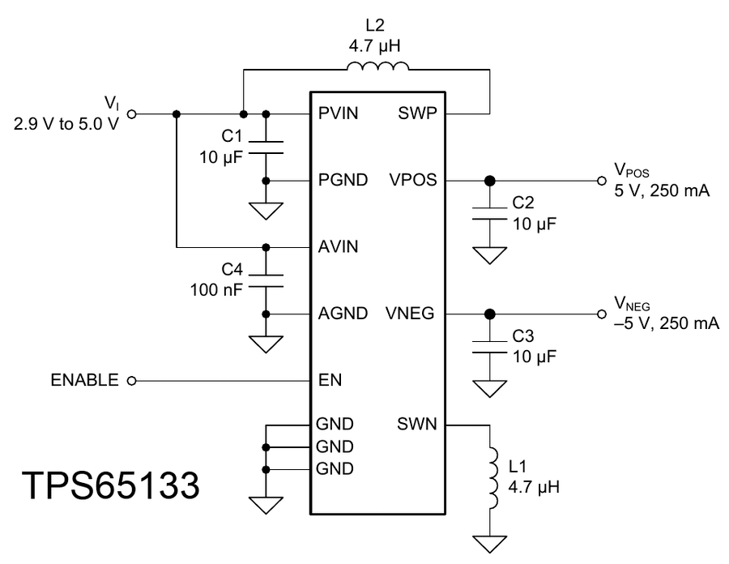
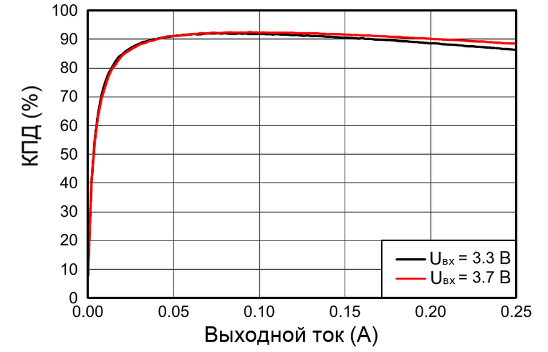
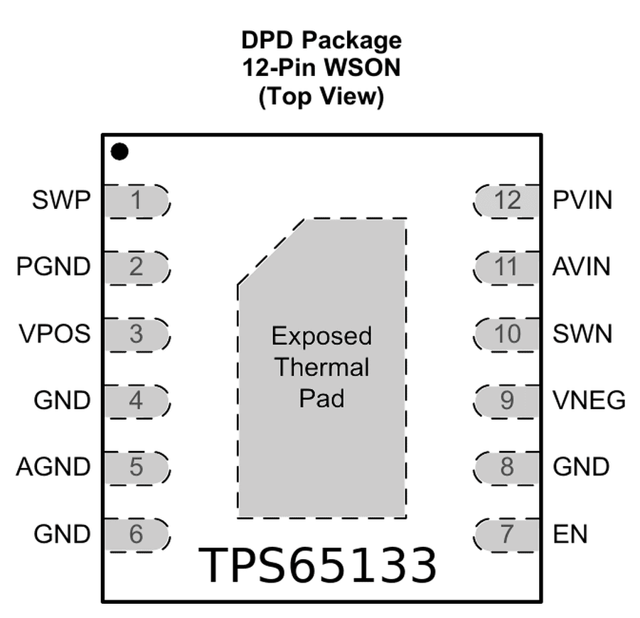

[Русский](./README.ru.md) | **English**

# A dual supply from a single supply for portable gear with the TPS65133

**Published:** 2018-09-03  
**Category:** Useful circuits  
**Tags:** DC-DC converter, power supply  
**Original:** https://audiogeek.ru/unipolar-to-bipolar-voltage-converter/

---

In the era of portable electronics, the question of powering portable devices becomes ever more pressing. A dual supply voltage, needed for example in a portable headphone amplifier, is particularly difficult. Today's electronics lets us overcome this problem. Let us look at how to make a dual supply from a single one using the TPS65133.

## **Options for a dual supply in portable gear**

Of course, you can use two batteries for a dual supply in portable gear. But that brings additional complications with charging them, and with the two rails becoming unbalanced as the batteries age.

A more advanced way to make a dual supply from a single one is to use a ***[DC-DC voltage inverter such as the MAX660 or MAX865](../otricatelnoe-napryajenie-iz-polojitelnogo/)*** or any other. But there is a problem here too. As the battery discharges, the negative voltage falls along with the positive. That is, with a charged battery the supply will be ±4.2 V, and with a discharged one ±3 V or even less.

This is where SEPIC converters come to the rescue. We will not go deep into the theory of the conversion process, which is a topic for a separate article. For now let us look at a single-to-dual voltage converter on the TPS65133.

## **A dual supply from a single supply with the TPS65133**

[**Download the TPS65133 datasheet**](./TPS65133.pdf)

The main advantage of this converter is that the output voltage is ±5 V regardless of the input voltage, which can be from 2.9 to 5 volts (up to 6 volts is permissible). That is, the chip is made for direct use with 3.6 V batteries. But nothing prevents you from powering it from USB or a power supply.

The conversion frequency here is 1.7 MHz. For audio devices that is an excellent option. At the same time no transformers are required, which most SEPIC converters need. Only an inductor is required for conversion, and thanks to such a high frequency it is fairly small.

**The circuit of the single-to-dual voltage converter on the TPS65133 looks as follows:**

Tantalum capacitors are preferable. It also does not hurt to add extra 0.1 µF capacitors to filter RF interference.

As for output current, everything is very good. The output current can reach 250 mA per rail. The manufacturer states that at output currents from 50 to 200 mA the converter's efficiency exceeds 90%, which is a very good figure for portable equipment.

## **A fly in the ointment**

For all its obvious advantages, the biggest drawback of this chip is its package. The chip comes only in a surface-mount package measuring 3x3 mm. The contact size is 0.6x0.2 mm, and the spacing between them is 0.25 mm.

Making a board with such contacts at home is not the easiest task. You can make life easier by buying a ready-made module with the chip and its supporting parts already soldered.

Incidentally, the TPS65133 is not the only one. The same family includes the TPS65130, TPS65131, TPS65132, TPS65135..... But either their characteristics are less interesting, or the package is even worse.

***I would be very grateful to anyone who can suggest chips with similar characteristics. I look forward to your comments.***

*Originally written for [AudioGeek.ru](https://audiogeek.ru). Translated from Russian.*
