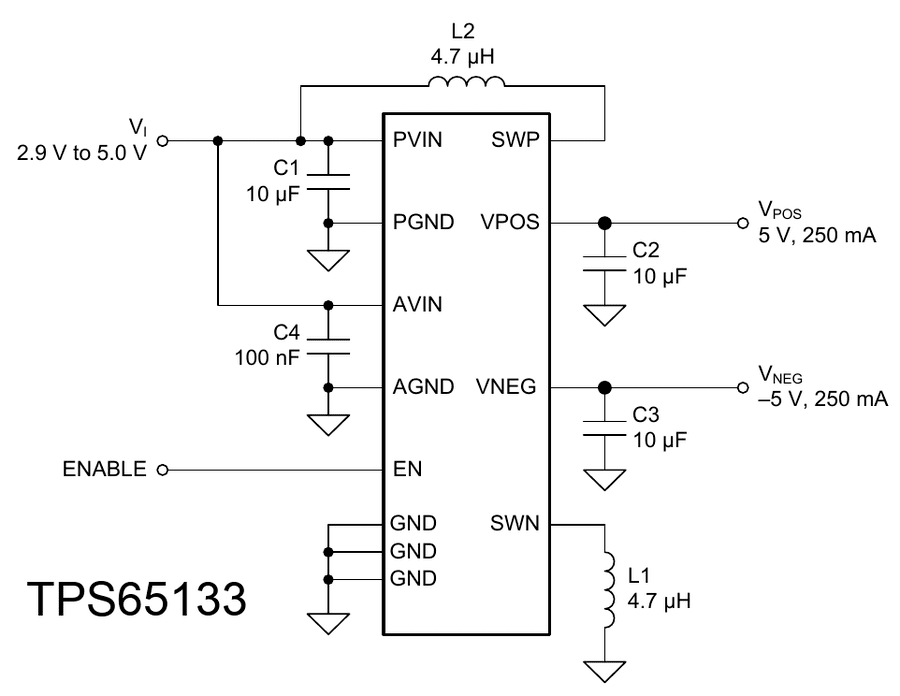
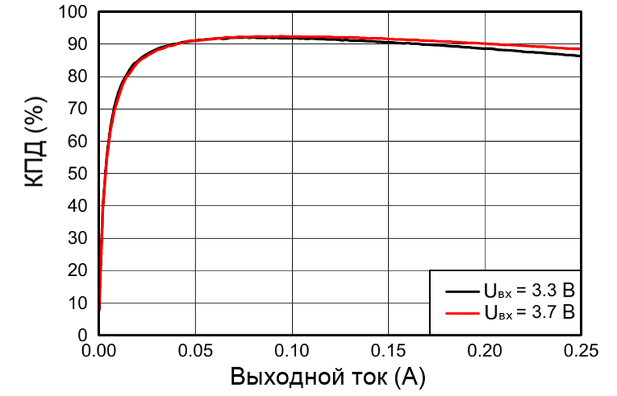
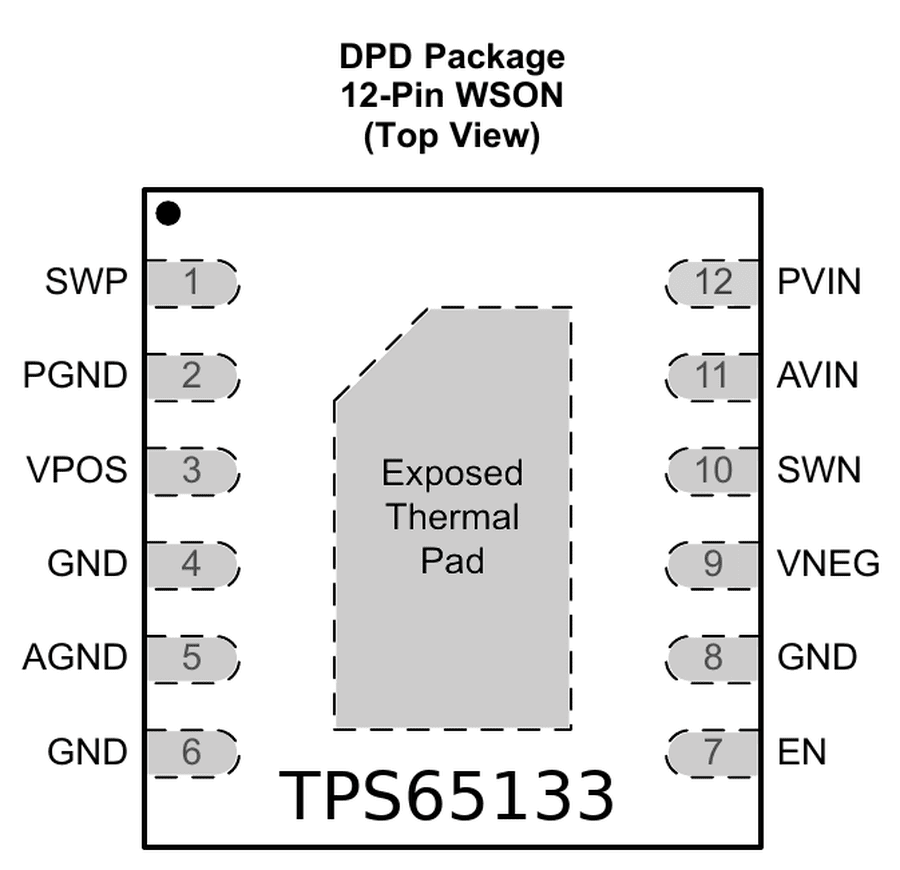

[English](./README.md) | **Русский**

# Двухполярное питание из однополярного для портатива на TPS65133

**Рубрики:** Полезные схемы  
**Метки:** DC-DC преобразователь, источник питания  
**Оригинал:** https://audiogeek.ru/unipolar-to-bipolar-voltage-converter/

---

В эру портативной электроники все острее встает вопрос о питания переносных девайсов. Особую сложность представляет двухполярное напряжение питания, необходимое например в портативном усилителе для наушников. Сегодняшнее развитие электроники позволяет преодолеть данную проблему. Рассмотрим как сделать двухполярное питание из однополярного на микросхеме TPS65133.

## **Варианты двухполярного питания для портатива**

Конечно для двухполярного питания в портативе можно воспользоваться двумя аккумуляторами. Но это приведет к дополнительным сложностям с их зарядкой, а также к расбалансу плеч по мере старения аккумуляторов.

Более продвинутый вариант сделать двухполярное питание из однополярного - использовать ***[dc-dc инвертор напряжения MAX660, MAX865](../otricatelnoe-napryajenie-iz-polojitelnogo/)*** или любой другой. Но и тут есть проблема. при разряде аккумулятора, вслед за положительным напряжением будет падать и отрицательное. Т.е. при заряженном аккумуляторе питание будет ±4.2, а при разряженном ±3 В или еще меньше.

И тут на помощь приходят SEPIC преобразователи. Не будем углубляться в теорию процесса преобразования - это тема отдельной статьи. А пока рассмотрим преобразователь однополярного напряжения в двухполярное на TPS65133.

## **Двухполярное питание из однополярного на микросхеме TPS65133**

[**Скачать Datasheet на TPS65133**](./TPS65133.pdf)

Главным достоинство этого преобразователя является то, что выходное напряжение составляет ±5В независимо от входного напряжения, которое может быть от 2.9 до 5 вольт (допустимо подавать до 6 вольт). Т.е. микросхема создана для непосредственного использования с 3.6 вольтовыми аккумуляторами. Но никто не запрещает запитать ее от usb или блока питания.

Частота преобразования тут 1.7МГц. Для аудио устройств это отличный вариант. При этом, для работы не требуется использование трансформаторов, которые нужны в большинстве SEPIC конвертеров. Для преобразования требуется только индуктивность которая, благодаря столь высокой частоте, достаточно мала.

**Схема преобразователя однополярного напряжения в двухполярное на TPS65133 выглядит следующим образом:**

Конденсаторы желательно устанавливать танталовые. Так же будет не лишним поставить дополнительно конденсаторы по 0.1 мкФ для фильтрации ВЧ-помех.

Что касается такого параметра как выходной ток, то тут все очень хорошо. Выходной ток может достигать 250 мА на плечо. Производитель заявляет, что при выходном токе от 50 до 200 мА КПД преобразователя превышает 90%, что является очень хорошим показателем для применения в портативной технике.

## **Ложка дегтя в бочку меда**

При всех очевидных плюсах, самым большим минусом данной микросхемы является ее корпус. Микросхема выпускается только в корпусе предназначенном для поверхностного монтажа, размерами 3х3 мм. Размеры контактов составляют 0.6х0.2 мм, а расстояние между ними 0.25 мм.

Изготовить плату с такими контактами в домашних условиях - не самое простое занятие. Можно облегчить себе жизнь, если купить готовый модуль со впаянной микросхемой и обвязкой.

Вообще TPS65133 не единственная. В этом же ряду есть микросхемы TPS65130 TPS65131, TPS65132, TPS65135..... Однако либо их характеристики мене интересны, либо корпус еще хуже.

***Буду очень признателен всем, кто подскажет микросхемы с аналогичными характеристиками. Жду Вас в комментах***

**Материал подготовлен исключительно для сайта [AudioGeek.ru](https://github.com/SkyTrip-13/AudioGeek)**
