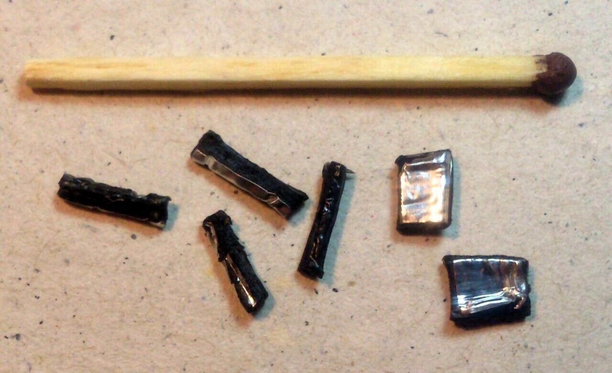
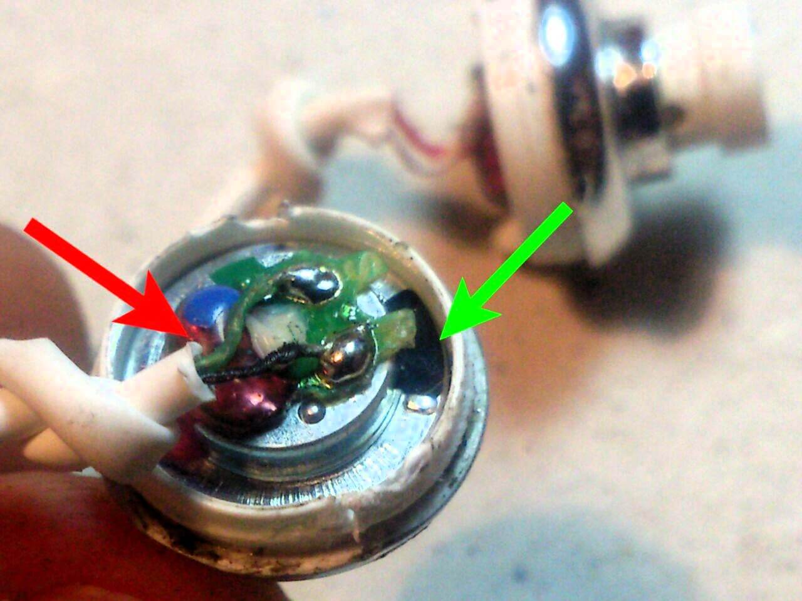
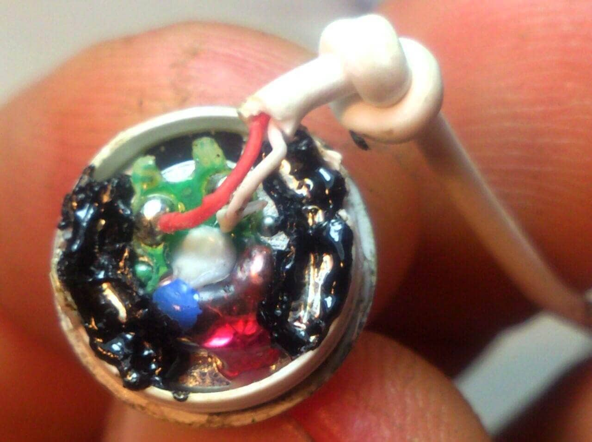
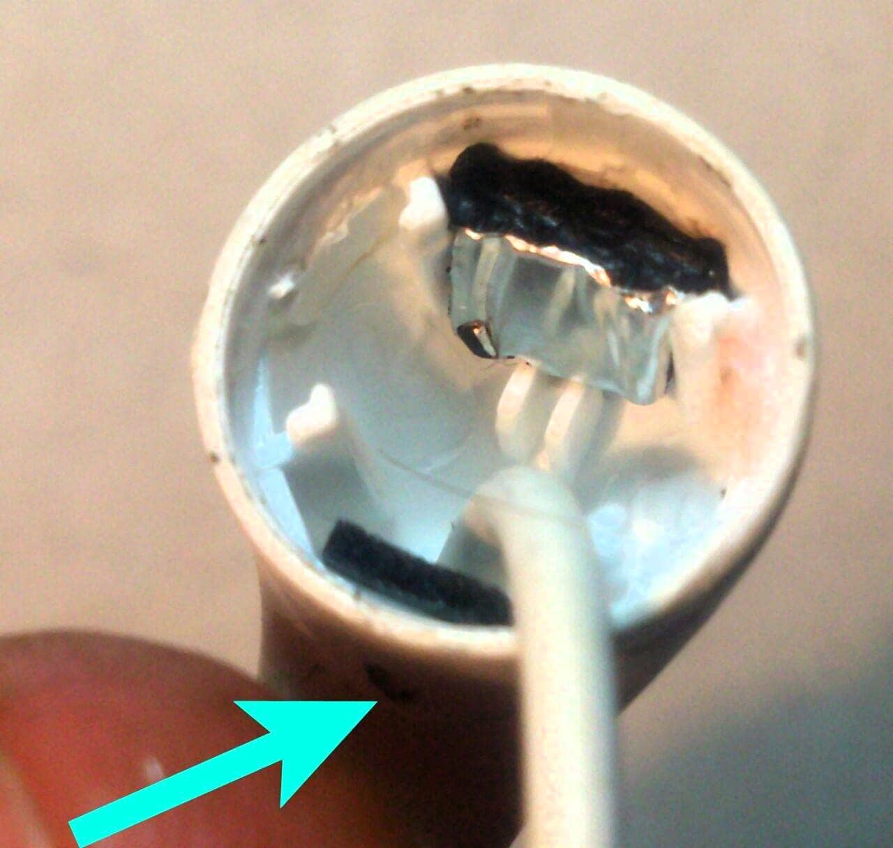
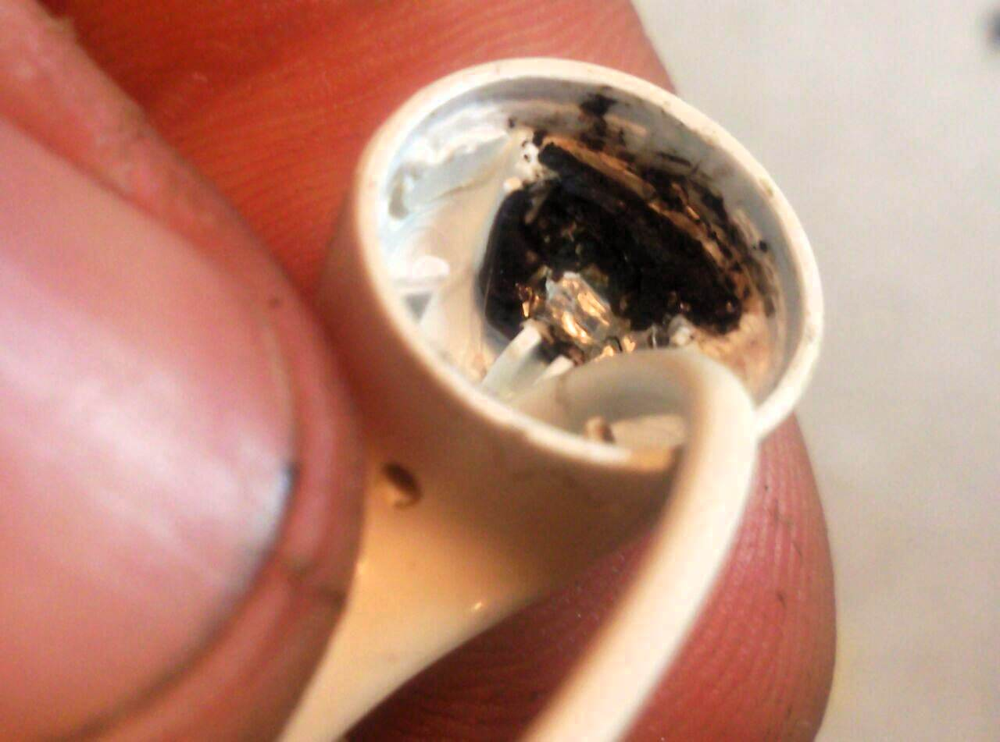

[Русский](./README.ru.md) | **English**

# Improving the sound of earbuds: an interesting mod

**Category:** Headphone mods  
**Original:** https://audiogeek.ru/vibra-vkladishi/

---

To simplify as much as possible, a headphone is a driver stuffed into a piece of plastic. But to make this construction sound good, various tricks are needed. Today let us look at one interesting mod that will help improve the sound of headphones in a simple way.

Today's article is about how to damp in-ear earbuds. But it will not be just damping; essentially it is vibration isolation. A similar mod has already been tried on the Sennheiser HD 380 Pro. You can read about it in ***[this article](../vibro-dempfirovanie/)***.

### **Who will we torment, and why?**

The role of patient is taken by a standard Samsung headset. I have already described how to open such headphones in ***another article***. Incidentally, the same headset appears there, lucky it :-D .

The problem with most headphones is plastic. It can resonate and add extra sounds that were not originally in the music. In addition, part of the outside sounds from the surrounding space is transmitted through the plastic.

All this affects the sound in not the best way. So it was decided to try to eliminate all these parasitic influences of the plastic. To improve the sound of the headphones I will use a material called foil-asphalt vibration damper (a bitumen-and-foil sheet, in Russian "folgaizol"), used for vibration isolation of car bodies.

This material was already described in detail in the ***[article mentioned above](../vibro-dempfirovanie/)***, which I recommend reading first.

## **Preparing for the process**

In the same **[previous article](../vibro-dempfirovanie/)** I sarcastically suggested that a matchhead of the damping material would be enough. I was not far from the truth :) this much is enough for both earbuds:

After opening one up we see roughly the following:

Since the main source of vibration is the driver, we will insulate it first of all :) With the green and red arrows I want to draw your attention to the places that are better left untouched.

The green arrow points to a hole in the driver covered with a mesh, which it needs to equalize the load in front of and behind the diaphragm. The red arrow points to the wires from the driver's voice coil, which are covered in glue. Damaging these wires **= death of the driver**.

We have settled what **not** to do, so now let us move on to the process itself.

## **How to improve the sound of earbuds**

Cut out pieces of the damping material and try them for fit. Heating such small pieces in front of a lamp is somehow inconvenient, so I decided to heat them with the soldering iron right in place :) After heating, it all looked like this:

It does not look very pretty, but it stuck on great. And the material softens instantly with the iron: before it even touches, it is already flowing. I pressed the slightly leaked droplets back in with a finger :)

Wonderful! The front wall is done. Now on to the earbud shell :-)

First of all, **an arrow again**, this time a turquoise one :) It points to a small hole which is apparently needed to equalize pressure: the pressure between the driver and your eardrum must **=** the pressure in the earbud shell, otherwise after inserting the earbud you would feel a plunger-like sensation in your ear for quite a while until your ear equalizes the pressure, which is not especially pleasant.

With such earbuds the volume of the shell generally does not much affect the sound, but still you should not fill all of it with damping material: first, a small piece is enough, and second, it makes the earbud heavier.

And here is another ugly photo after heating with the soldering iron :)

I placed a piece of the damper between two ribs. The tips of these ribs rest against the driver and support it. During assembly I had to trim them, since now they started pressing against the damping material.

Now both parts must be glued back together. It is better not to pour superglue directly onto the parts being glued, otherwise you can accidentally flood something that should not be glued.

It is better to put a good drop of glue on a matchbox and, dipping a screwdriver or a thick needle into the drop, coat the part. Superglue simply sitting in the air dries quite slowly; it does so much faster if it is squeezed. So after applying it, quickly press the parts together firmly and hold for 10–15 seconds. As it dries the glue heats up and the glued surfaces fuse slightly.

## **Listening to the result**

The comparison was done on two headsets: the first is our patient, the second the same but not spoiled by life. I compared them head to head, and also wore each for a week. I always used the same source: a **HiFiMan HM-601** with a completely rebuilt analog section (about that some other time).

By my subjective impression it became much better. These earbuds have slightly boosted lows, and because of that on heavy music they merged into mush; now the lows have become tighter and clearer, every hit is separate. The boominess has gone from a heavily overdriven guitar and a bass guitar.

There are not fewer lows; they are now clearer, and on some bands it feels as if the drummer is a bit farther away than before, i.e. the depth of the soundstage increased.

All sounds became more readable and no longer blend into mush, on any music from dubstep or club music with its clearly audible deep bass to the heaviest metal where the bass drum's bursts are distinguishable hit by hit. But the main plus is that the droning in the mid-bass is gone.

Overall the effect turned out to be the same as **[on full-size headphones](../vibro-dempfirovanie/)**, perhaps even a bit more noticeable, because the damper was glued directly to the driver itself.

After wearing them for two weeks, switching back to the unmodded pair, I realized that thanks to the vibration damping and suppression of shell vibrations you stop feeling the earbuds in your ears completely and simply forget about them. With the regular ones I got used to them too, but I still felt them.

Noise isolation also increased, which is very relevant on transport :)

*Originally written for [AudioGeek.ru](https://audiogeek.ru). Translated from Russian.*
