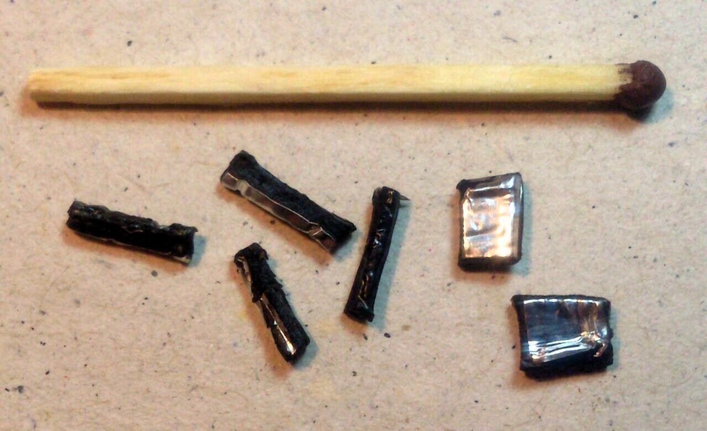
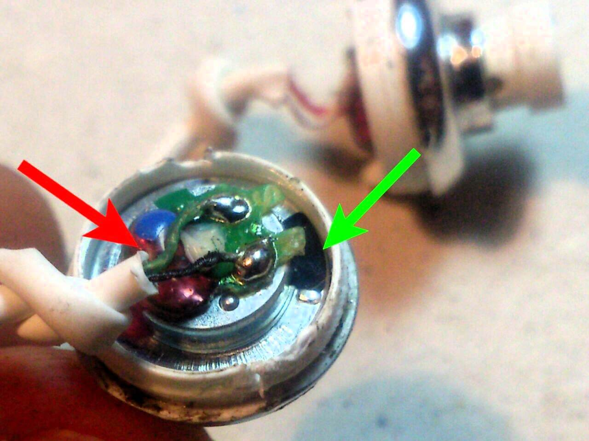
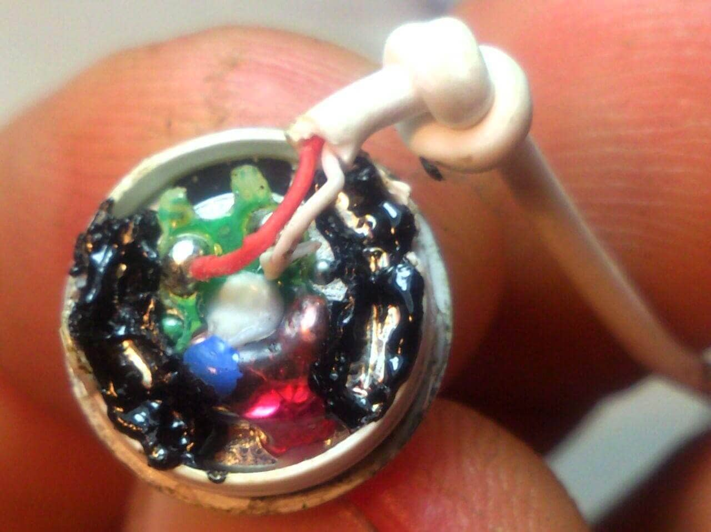
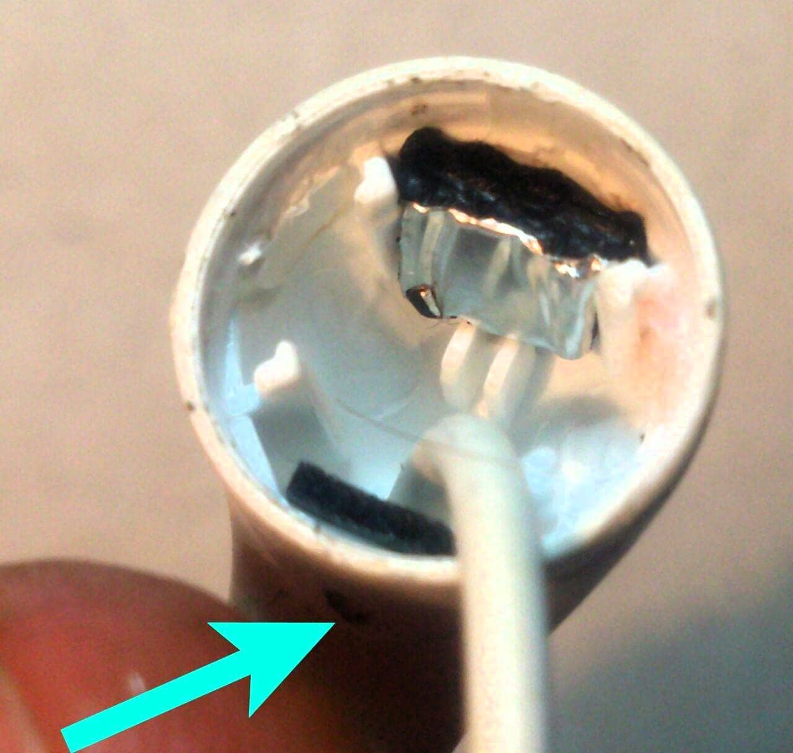
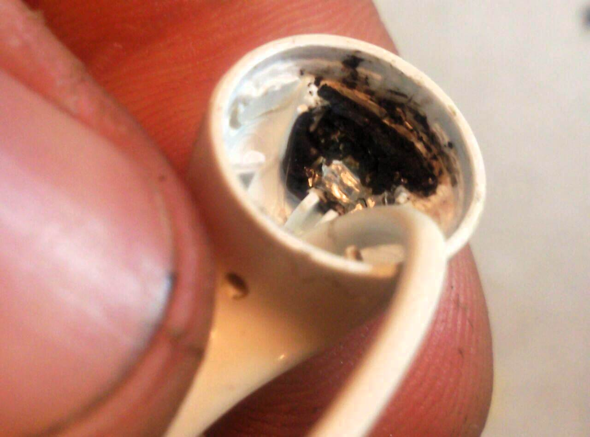

[English](./README.md) | **Русский**

# Улучшить звук наушников - интересный мод

**Рубрики:** Доработка наушников  
**Оригинал:** https://audiogeek.ru/vibra-vkladishi/

---

Если все максимально упростить, то наушник - это динамик засунутый в кусок пластика. Но чтобы заставить эту конструкцию хорошо звучать необходимы различные уловки.  Рассмотрим сегодня один интересный мод, который поможет простым путем улучшить звук наушников.

Речь в сегодняшней статье пойдет о том, как демпфировать наушники-вкладыши. Но это будет не просто демпфирование, а по сути виброизоляция. Аналогичный мод уже был опробован на наушниках Sennheiser HD 380 Pro. Почитать об этом можно в ***[этой статье](../vibro-dempfirovanie/)***.

### **Кого и зачем будем мучать?**

Роль пациента примет на себя стандартная гарнитура Samsung. О том как можно вскрыть такие наушники я уже рассказывал в ***другой статье***. Там кстати эта же гарнитура, везет же ей :-D .

Проблемой большинства наушников является пластик. Он может резонировать и вносить лишние звуки, которых в музыке исходно нет. Помимо это через пластик передается часть внешних звуков из окружающего пространства.

Все это не самым лучшим образом влияет на звук. Поэтому было решено попробовать устранить все эти паразитные влияния пластика. Чтобы улучшить звук наушников будет применен материал называемый фольгаизол и используемый при виброизоляции кузова автомобиля.

Подробно этот материал уже был описан ***[указанной выше статье](../vibro-dempfirovanie/)***. С которой я рекомендую предварительно ознакомиться.

## **Подготовка к процессу**

Во все той же **[предыдущей статье](../vibro-dempfirovanie/)** я саркастично предположил что хватит и спичечной головки фольгаизола. Я был не далек от истины :) на оба наушника хватит вот столько:

После вскрытия видим примерно следующее:

Т.к. Основным источником вибрация является динамик, то его то мы первым делом и заизолируем) Зеленой и красной стрелочками я хочу обратить ваше внимание на те места которые лучше не трогать.

Зеленая стрелка - указывает на заклеенное сеточкой отверстие в динамике, необходимое ему, для уравнивания нагрузки перед и за диффузором. Красная стрелочка показывает на залитые клеем проводки идущие от катушки динамика. Повреждение этих проводков **= смерти динамика**.

Чего делать **не стоит** мы определились, теперь перейдем к самому процессу.

## **Как улучшить звук наушников**

Вырезаем кусочки фольгаизола и примеряемся. Нагревать такие маленькие кусочки перед лампой как-то не удобно поэтому было решено нагревать паяльником прям по месту) После нагревания выглядело все это вот так:

Выглядит не шибко красиво, зато вклеилось отлично. Причем паяльником фольгаизол размягчается моментально, еще коснуться не успел, он уже плывет. Слегка вытекшие капельки я вмял пальцем обратно)

Замечательно! С передней стенкой разобрались. Теперь перейдем к чаше наушника :-)

Первым делом - **опять стрелка**, на этот раз бирюзовая) Это стрелка указывает на маленькую дырочку, которая по всей видимости необходима для уравнивая давления т.е. давление между динамиком и вашей барабанной перепонкой должно быть **=** давлению в чаше наушника, иначе после вставление наушника довольно долго будет ощущение вантуза в ухе, пока ваше ухо не уровняет давление, а это как-то не особо приятно.

У таких наушников, как правило, объем в чаще не особо влияет на звук, но все же не стоит заполнять его весь вибропоглащающим материалом, во первых хватит и небольшого кусочка, во вторых это утяжеляет наушник.

Ну и вот еще одна страшненькая фота после нагревания паяльником :)

Кусочек фольгаизола я расположил между двумя ребрышками. Эти ребрышки своими кончиками упираются в динамик и поддерживают его. Во время сборки наушников их пришлось подрезать, так как теперь они начали упираться в фольгаизол.

Теперь необходимо склеить обратно обе части. Лучше не лить супер-клей прямо на склеиваемые части, иначе можно случайно залить клеем что-то лишнее.

Лучше налить добрую капельку клея на спичечный коробочек и, макая в капельку отверткой или толстой иглой, промазать деталь. Супер-клей находясь просто на воздухе сохнет довольно медленно, гораздо быстрее он это делает если его сжимать. Так что намазав, быстро и плотно прижимаем части и держим секунд 10-15. В процессе высыхания клей нагревается и склеиваемые поверхности немного сплавляются.

## **Слушаем что получилось**

Сравнение проводилось на двух гарнитурах - первая - наш пациент, а вторая такая же, но не испорченная жизнью. Сравнивал и лоб в лоб, и по неделе ходил в каждой из них. Источник всегда использовал один и тот-же: **HiFiMan  HM-601** с полностью переделанной аналоговой частью начинки(об этом как-нибудь в другой раз)

По моим субъективным ощущениям стало намного лучше. У этих наушников немного задраны низкие и из-за этого на тяжелой музыке они сливались в кашу, теперь же низкие стали более собранными и четкими, каждый удар разделен. У сильно перегруженной гитары и у бас гитары ушла гулкость.

Низких не стало меньше, теперь они четче, и на некоторых группах ощущение что барабанщик находится немного дальше чем был, т.е. Увеличилась глубина сцены.

Все звуки стали более читаемые и не смешивающимися в кашу, причем на любой музыке от дубстепа или клубняка в котором четко слышен низкий бас, до самого тяжелого металла в которм очереди бас-барабана различимы каждым ударом. Но главный плюс  - пропало гудение на мид-басе.

В целом эффект оказался тем же, что и **[на полноразмерных наушниках](../vibro-dempfirovanie/)**, возможно даже немного более заметным, т.к. вибропоглотитель клеился непосредственно на сам динамик.

После двух недель их ношения, переходя на незамоденный вариант, понял, что благодаря  вибродемпфированию и гашению колебаний корпуса, наушники абсолютно перестаешь чувствовать в ушах, просто забывая о них. С обычными ушами я все равно хоть и привыкал, но чувствовал их.

Ну и так же возросла шумоизоляция, что очень актуально для транспорта)

***Материал подготовлен исключительно для сайта [AudioGeek.ru](https://github.com/SkyTrip-13/AudioGeek)***
