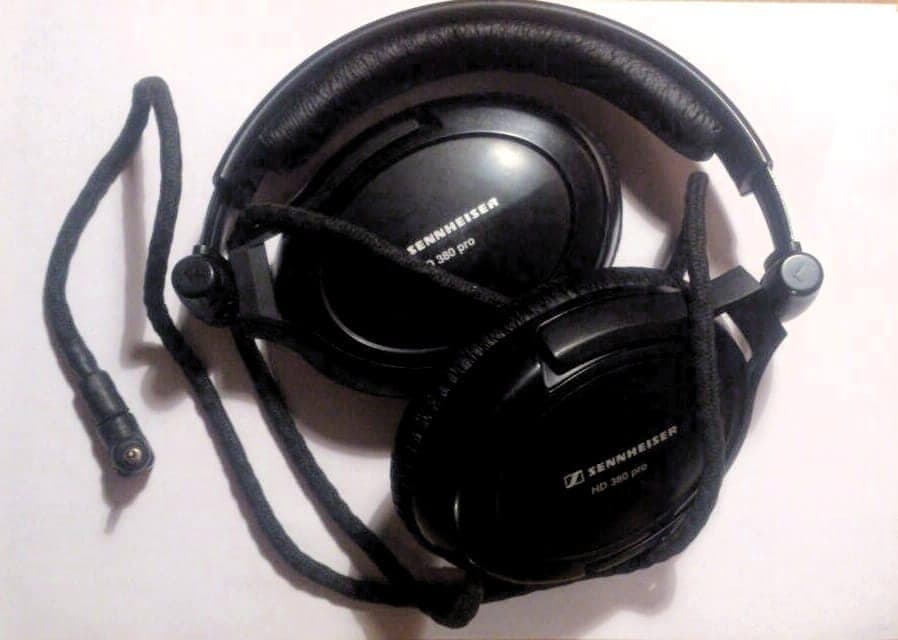
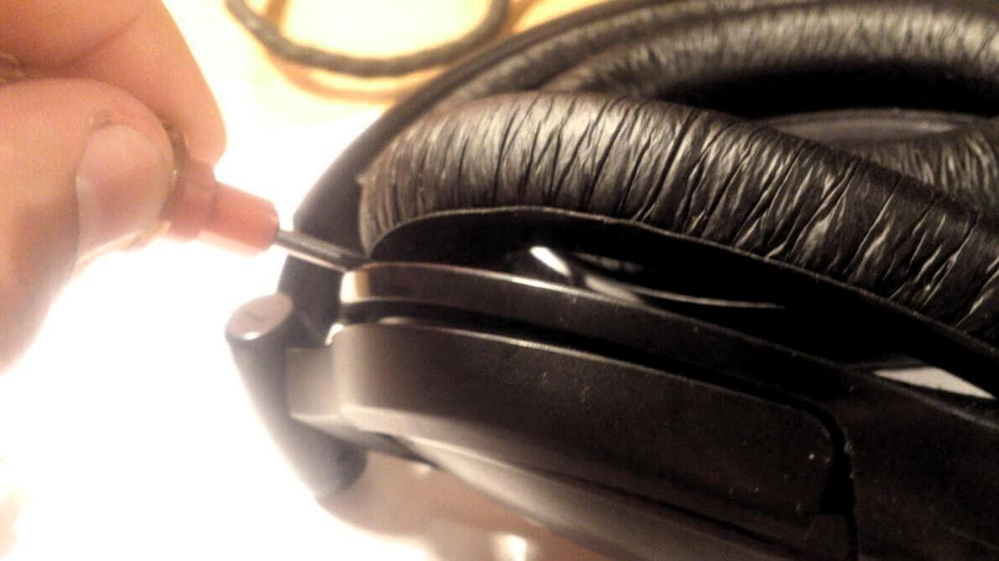
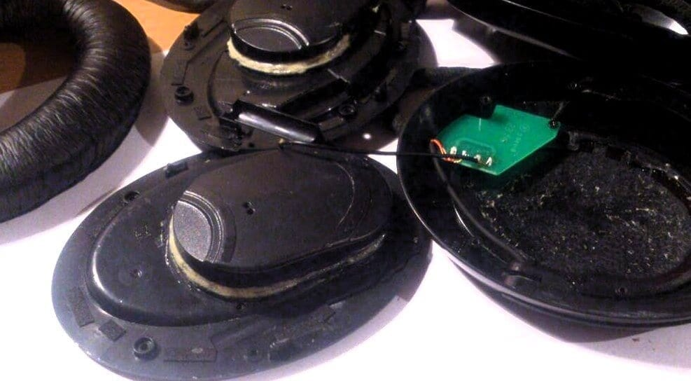
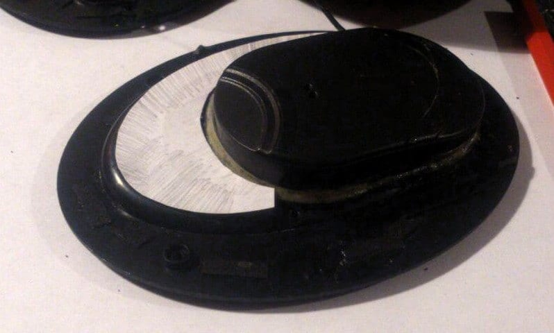
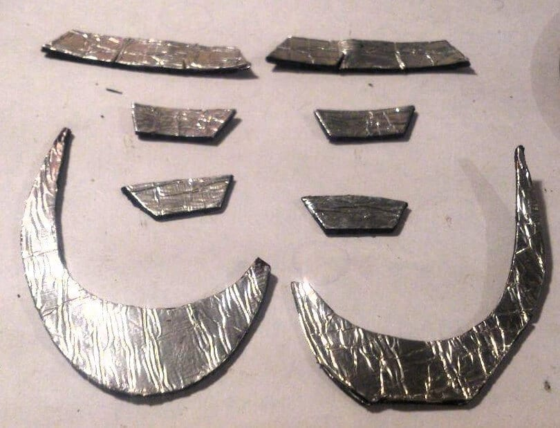
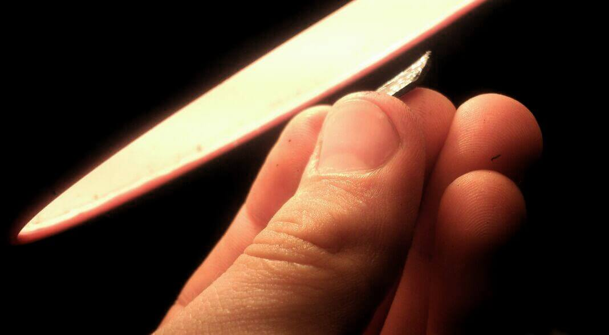
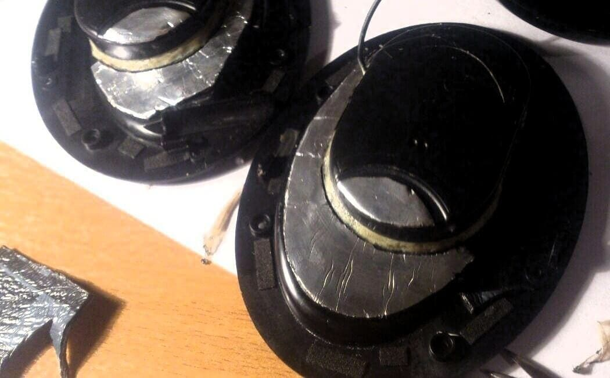
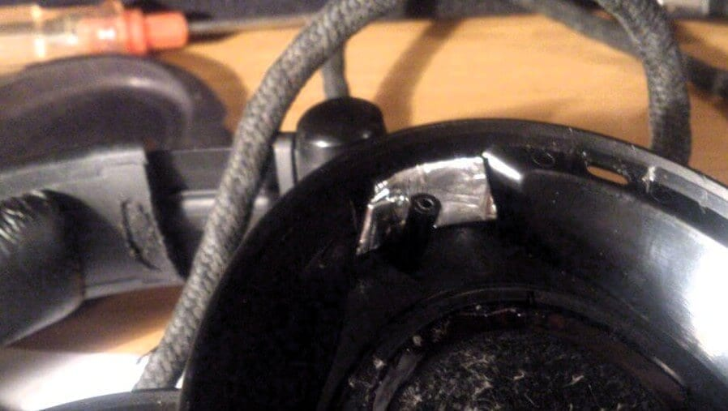
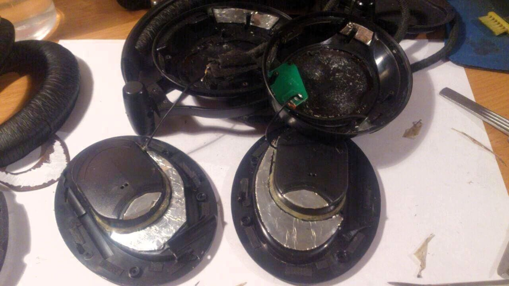

[Русский](./README.ru.md) | **English**

# Damping headphones with a vibration absorber

**Category:** Headphone mods  
**Tags:** sennheiser hd380 pro  
**Original:** https://audiogeek.ru/vibro-dempfirovanie/

---

The vast majority of headphones are made with plastic housings. That is not the best material for sound. Plastic can resonate and degrade the sound of headphones. So today's article on damping headphones is rather about damping the headphone housing.

## **What a vibration absorber is**

Any viscous [amorphous material](https://en.wikipedia.org/wiki/Amorphous_solid) can serve as a vibration absorber: bitumen, raw rubber, caoutchouc, modeling clay... People use all sorts of things... The main thing is that the material fits as tightly as possible to the surface subject to vibration and keeps its properties under operating conditions.

In that case all oscillations of the surface are transmitted to the material, where they are damped thanks to its structure.

> ### **Interesting fact:**
>
> *Bitumen is an* ***amorphous substance****, that is, in the solid state it shows the properties of a liquid. To prove it, in 1927 Thomas Parnell of the University of Queensland put bitumen in a funnel and waited for it to flow out. The experiment succeeded: the first drop fell eight years later, for which Parnell was later awarded the* ***Ig Nobel Prize.***

## Choosing the material

In car sound insulation, a material based on bitumen and/or rubber has recently become very popular. It is called "folgaizol" in Russian (brands such as Vizomast, Bimast, Vibroplast) and is used for vibration isolation of car bodies. I will call it a bitumen-foil damper here.

This material is quite interesting. It is sold by the meter from rolls or in cut rectangular pieces, and it is a layer of bitumen (from 1 to 8 mm thick) with some kind of fiber inside.

On one side the bitumen is covered with aluminum foil, on the other with a thin polyethylene film. Unlike pure bitumen, the material is not flammable, even in an open flame, personally tested ))

Bitumen has in fact been used as a vibration absorber for a relatively long time. For example, in my car, born at AvtoVAZ in 1979, it was glued to the inner surfaces of the floor and doors.

But pure bitumen is not very practical, for example for the reason that after a few years it tries to crystallize and hardens. When I peeled it off the car it flew apart in shards...

## **Why this is needed**

The title did say "**headphones**", and here I am telling you all about bitumen and cars :p

The headphone housing is a surface subject to vibration. This is especially true of plastic headphones, which are the majority (headphones with wooden housings are not considered).

### ***And what is bad about that? you will ask***

- What is bad is that vibration is a mechanical wave traveling through a material. If a section of this material equals 0.5 – 1 – 2 – 3.... wavelengths, it starts to resonate at that frequency, i.e. to add sounds that were not originally in the music itself.

This contributes to "muddying" of the sound, droning, and loss of clarity and instrument separation in the mix. Moreover, the headphone housing can resonate not only from driver vibrations but also from external, outside noise. So noise isolation improves along the way :) How about that :)

All these considerations, plus the urge to tinker, gave birth to the idea of vibration isolation of the headphone housing.

## Damping headphones with a vibration absorber

The test subject is headphones from the famous German company Sennheiser, model HD 380 Pro. Here they are:

The headphones are positioned as studio monitors and fully live up to their specs and price.

### **So let us BEGIN**

The first thing we have to do is of course take them apart. Though perhaps fans of Lady Gaga will like the idea of gluing on the outside too.

*I very much doubt you could prove in a service center that I had anything to do with you ruining your headphones, but for decency's sake I should still warn you that you do all of this at your own risk :-P*

The earpads are held on by clips; pry them off with a screwdriver:

Unscrew all the screws that catch our eye and take out the front wall with the driver. Do the same with the second earcup and study the insides:

In these headphones the engineers decided to cover the driver with a plastic cover, which I strongly advise against peeling off: you can damage the driver's diaphragm and/or the very thin wires going to the coil.

I could not resist and tore this cover off. I did it in order to glue the material onto the inner surface. More about that, and about what can happen to the driver, in the article: ***[Taking apart and lightly damping the Sennheiser HD 380 Pro](../dempf-senhi-hd380pro/).***

Since the main source of vibration is the driver, rigidly glued to the front wall, we will insulate that first of all :)

## **Cutting the blanks**

The damper is quite viscous and cutting it to fit is not very convenient, so let us make a paper template:

Makers of this damping material recommend covering 50 to 100% of a metal surface with it. For plastic 10–30% of the surface is enough.

Nobody forbids covering the entire interior with it, but even with the thinnest material you will still reduce the internal volume of the cups. And of course all the openings for air to pass must stay open.

I will limit myself to gluing small pieces onto each part of the headphone. Besides reducing the internal volume, the weight of the headphones increases, which must also be taken into account. Here are the resulting blanks:

## **Gluing onto the surfaces**

Now we have reached the most interesting part: gluing. I mentioned the polyethylene film on one side of the material.

This protective film must be peeled off to expose the bitumen layer. We will not need any glue, just an ordinary lamp with an incandescent bulb:

In this simple way we heat our pieces for as long as the hands can stand it. The hands usually tolerate up to about 70 degrees. That is quite enough for the material to become like soft modeling clay.

Now, before it cools, quickly apply it to the intended place, press it down well and smooth it out:

On the cups themselves I decided to glue quite small pieces, because I was afraid of problems closing the headphones afterwards. It came to about 3 pieces per earcup:

And the overall view:

## **Assembling and listening...**

In my opinion the expectations were met. After this mod the sound became "more sterile" and every instrument is separated much more clearly and does not climb over its neighbor.

I recommend you carry out all these experiments with your handy hands and ears too. This mod is applicable not only to full-size headphones but also to earbuds.

I could not resist and also did the ***[vibration isolation of in-ear earbuds](../vibra-vkladishi/)***. I can say that the sound of the Samsung headset became clearly better.

**Good luck!**

*Originally written for [AudioGeek.ru](https://audiogeek.ru). Translated from Russian.*
