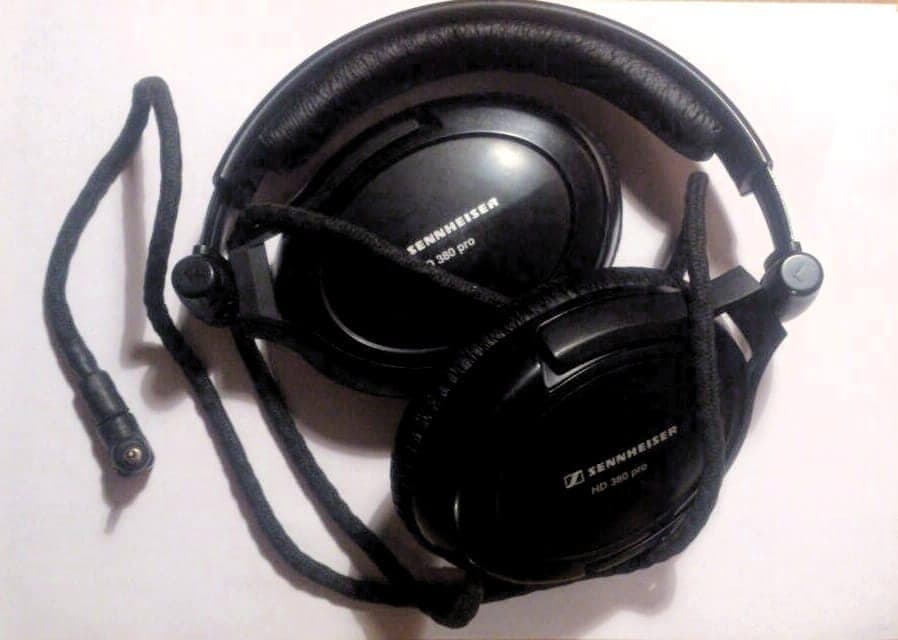
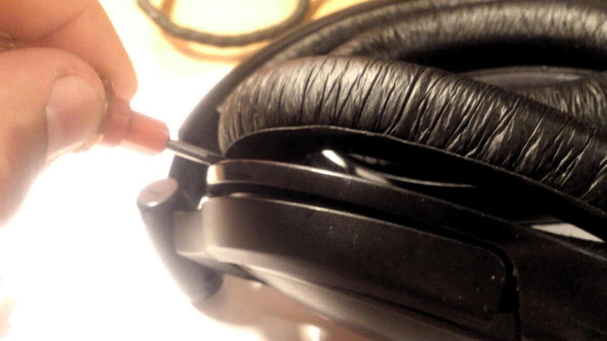
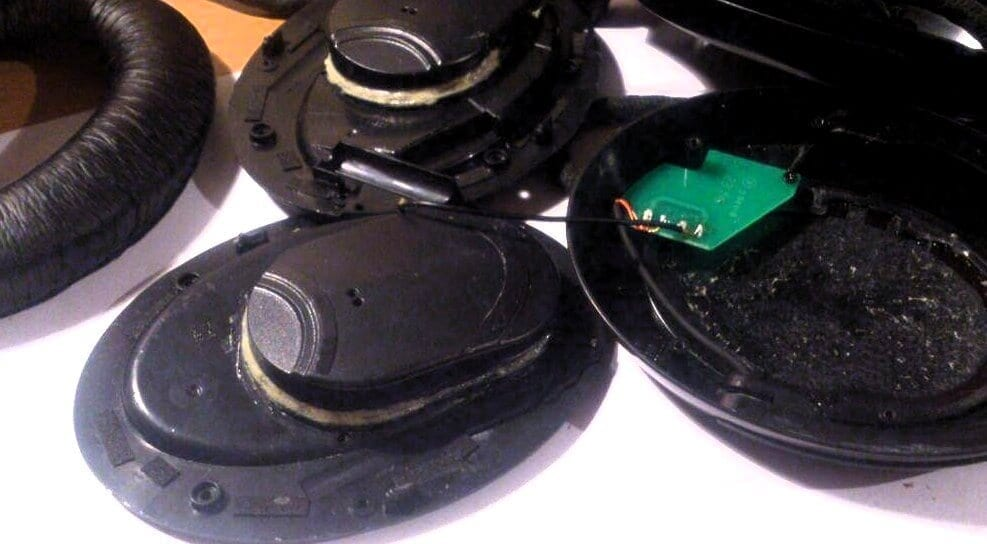
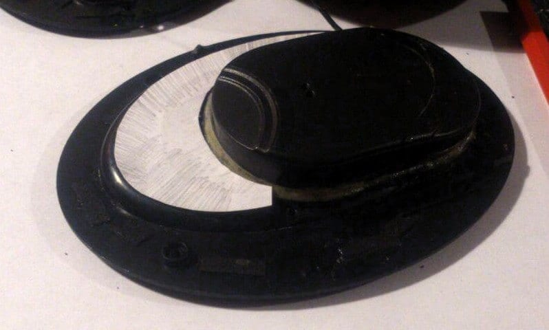
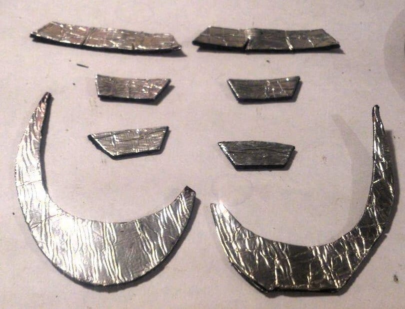
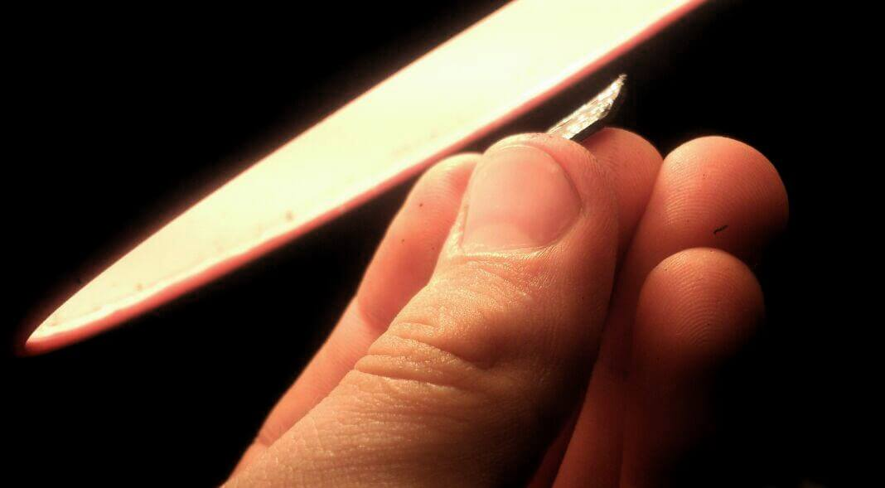
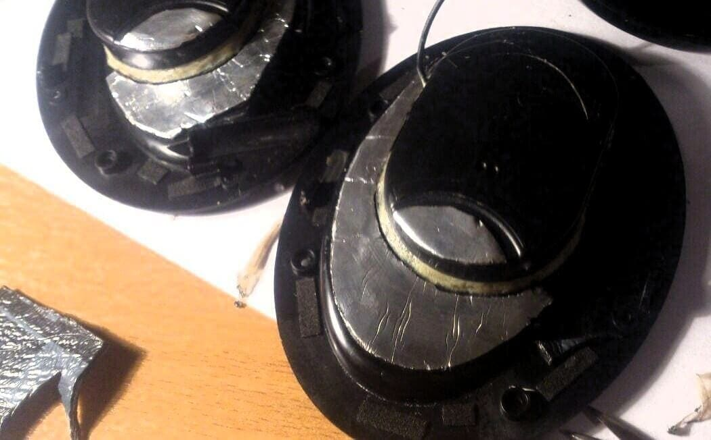
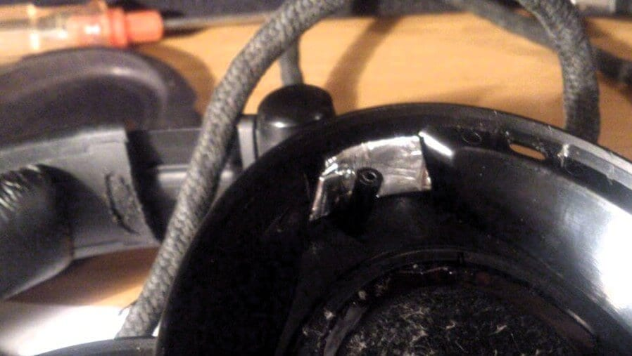
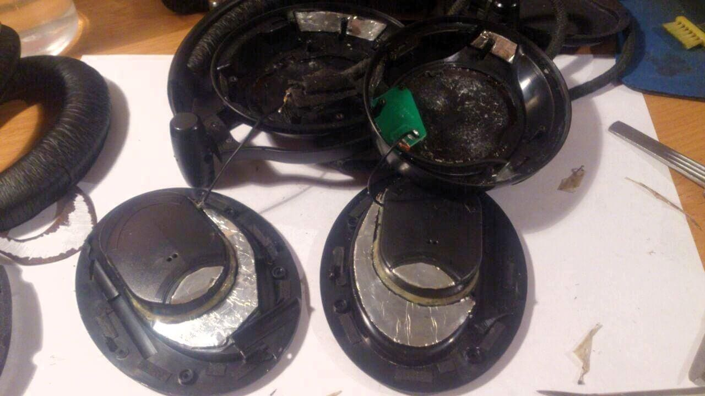

[English](./README.md) | **Русский**

# Демпфирование наушников вибропоглотителем

**Рубрики:** Доработка наушников  
**Метки:** sennheiser hd380 pro  
**Оригинал:** https://audiogeek.ru/vibro-dempfirovanie/

---

Подавляющее большинство наушников выпускается в пластиковых корпусах. Это не самый лучший материал для звука. Пластик может резонировать и ухудшать звук наушников. Поэтому сегодняшняя статья про демпфирование наушников скорее про демпфирование корпуса наушников.

## **Что такое вибропоглотитель**

В качестве вибропоглотителя применим любой вязкий [аморфный материал](https://ru.wikipedia.org/wiki/Аморфные_вещества), такой как битум, сырая резина, каучук, пластилин... Что только народ не использует... Главное чтобы материал максимально плотно прилегал к поверхности, подверженной вибрациям, и сохранял свои характеристики в условиях эксплуатации.

В таком случае все коллебания поверхности передаются и на материал, в котором они гасятся благодаря его структуре.

> ### **Интересный факт:**
>
> *Битум является* ***аморфным веществом****, то есть в* *твердом* *состоянии проявляет свойства жидкости. Чтобы доказать это, в 1927 году сотрудник* *Квинслендского университета* *Томас Парнелл поместил битум в воронку и стал ждать, когда он вытечет. Эксперимент удался: первая капля упала уже через восемь лет, за что Парнелл и удостоился* ***Шнобелевской премии.***

## Выбор материала

В автомобильной шумоизоляции, в последнее время, большую популярность приобрел материал, на основе битума и/или каучука, называемый в народе фольгаизол (Визомаст, Бимаст, Вибропласт) и применяемый для виброизоляции кузова.

Материал этот весьма интересен. Продается он метражом из рулонов либо нарезанными кусками прямоугольной формы и представляет из себя слой битума (встречается от 1 до 8 мм толщиной), внутри которого находится какое-то волокно.

При этом с одной стороны битум обклеен алюминиевой фольгой, со второй полиэтиленовой пленочкой. В отличие от чистого битума, материал не горюч, даже на открытом огне, проверенно лично))

Вообще битум как вибропоглотитель используется уже относительно давно, для примера, в моей машине, рожденной АвтоВАЗом в 79 году, им были обклеены внутренние поверхности пола и дверей.

Но чистый битум не очень практичен, например, хотя бы по той причине, что через несколько лет он пытается кристаллизоваться и твердеет. Когда я отдирал его от машины он разлетался осколками...

## **Зачем это нужно**

В теме вроде как прозвучало слово “**наушники**”, а я тут Вам все про битум да про машины парю :p

Корпус наушников является поверхностью подверженной вибрациям. Особенно это относится к наушникам из пластмассы, коих большинство ( наушники с деревянными корпусами не рассматриваются).

### ***Чем же это плохо ? - спросите Вы***

- А плохо это тем, что вибрация - это механическая волна, распространяющаяся по материалу. Если участок этого материала равен 0,5 - 1 - 2 - 3.... длинам волн, то он начинает резонировать на этой частоте, т.е. вносить звуки, которых изначально в самой музыке нет.

Это способствует “*замыливанию*” звука, гудению и потере четкости и разделения инструментов в миксе. Причем, корпус наушников может резонировать не только от вибраций динамика, но и от внешних, наружных шумов. Так что попутно и шумоизоляция повышается) О как)

Исходя из всех этих соображений и желания рукоделия и родилась идея виброизоляции корпуса наушников.

## Демпфирование наушников вибропоглотителем

В качестве подопытного выступают наушники прославленной немецкой конторы Sennheiser, модель HD 380 pro. Вот собственно и они:

Наушники позиционируются как мониторные и вполне оправдывают свои характеристики и стоимость.

### **Итак ПРИСТУПИМ**

Первое что нам придется сделать - конечно же разобрать их. Хотя, возможно, поклонниками леди гаги придется по вкусу идея обклеивать и снаружи.

*Я очень сомневаюсь, что вы сможете доказать в сервисе мою причастность к запарыванию Вами наушников, но ради приличия стоит все таки предупредить, что все действия Вы делаете на свой страх и риск :-P*

Амбушюры держатся на защелках, поддеваем их отверткой:

Откручиваем все винтики, которые попадаются нам на глаза и вынимаем переднюю стенку с динамиком, проделываем все тоже со вторым наушником и изучаем внутренности:

В этих наушников инженеры придумали закрыть динамик пластиковым кожухом, отклеивать который очень не советую - можно повредить диффузор динамика и/или тонюсенькие проводки идущие к катушке.

Я же не удержался и оторвал этот кожух. Сделано это было с целью обклеить внутреннюю поверхность материалом. Подробнее об этом и о том что может приключиться с динамиком в статье: ***[Разбор и легкое демпфирование Sennheiser HD 380 Pro](../dempf-senhi-hd380pro/).***

Так как основным источником вибраций является динамик, жестко приклеенный к передней стенке, то ее то мы в первую очередь и заизолируем)

## **Вырезаем заготовки**

Фольгаизол достаточно вязок и вырезать по месту его не совсем удобно, то сделаем шаблон из бумаги:

Производители фольгаизола рекомендуют обклеивать им от 50 до 100% поверхности металла. Для пластика же достаточно 10-30% поверхности.

Никто не запрещать обклеить им всё внутреннее пространство, но даже при использовании самого тонкого фольгаизола Вы все же уменьшите внутренний объем чаш. Ну и само собой все отверстия для прохождения воздуха должны оставаться открытыми.

Я ограничусь приклейкой небольших кусочков на каждую деталь наушника. Т.к. помимо уменьшения внутреннего объема увеличивается вес наушников, что так же стоит учитывать. Вот получившиеся заготовки:

## **Обклеиваем поверхности**

Вот мы и добрались до самого интересного - поклейки. Я говорил про полиэтиленовую пленочку с одной из сторон фольгаизола.

Эту защитную пленочку необходимо оторвать и оголить слой битума. Нам не понадобится никакого клея, а понадобится обычный светильник с лампой накаливания:

Вот таким нехитрым способом нагреваем наши кусочки до тех пор пока руки терпят. А терпят руки обычно до градусов 70. Этого вполне достаточно для того, чтобы фольгаизол стал как мягкий пластилин.

Теперь пока он не остыл, быстренько прикладываем его к намеченному месту, прижимаем хорошенько и разравниваем:

К самим чашам я решил приклеить совсем маленькие кусочки потому, что боялся проблем с последующим закрыванием наушников, получилось про 3 кусочка на наушник:

Ну и общий вид:

## **Собираем, слушаем...**

На мой взгляд предположения оправдались. После данного мода звук стал “стерильнее” и каждый инструмент гораздо четче разделен и не налезает на соседний.

Рекомендую и вам проделать все эти изыскания очумелых ручек и ушек. Такой мод применим не только к полно-размерным наушникам, но и к затычкам в том числе.

Я не удержался и провел ***[виброизоляцию наушников вкладышей](../vibra-vkladishi/)***. Могу сказать, что звук гарнитуры самсунг стал явно лучше.

**Материал подготовлен исключительно для сайта [AudioGeek.ru](https://audiogeek.ru)**

---

**Успехов!**
