[Русский](./README.ru.md) | **English**

# Equalizing a voice recording in Audacity

**Category:** Audio processing  
**Tags:** Audacity, sound quality, audio processing  
**Original:** https://audiogeek.ru/voice-eq-audacity/

---

Different microphones record sound very differently. Even the same microphone connected to different devices will record the same sound slightly differently. We will not look at why that happens, and instead see how a finished recording can be equalized.

> The screenshots show the Russian-language interface of Audacity. The English menu names are given in the text.

## Equalizing a voice recording

I would not like to turn this article into an endless wall of text, and you cannot cover everything anyway. So we will look at the main points and general recommendations using voice recording equalization as an example. Knowing them, you will have no trouble reaching the result you want by experiment for any recording.

As usual, all the work is done in the simple and free Audacity. Each step is shown and explained separately. In fact they can be combined into one pass, but that would be harder to understand.

> Equalization, like any other audio processing, is best done with headphones. If your favorite headphones broke at the worst possible moment, the article ***[Fixing headphones with your bare hands, no soldering iron!](../remont-naushnikov-bez-payalnika/)*** will help you repair them quickly.

## The equalizer

Open the program and drop the recording into it:

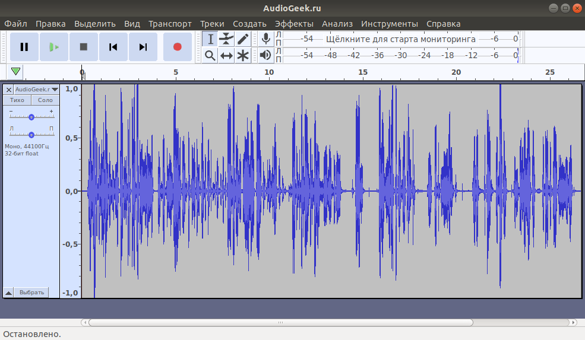

> The recording was already cleaned of noise and leveled in volume beforehand. This article can generally be seen as a supplement to ***[How to quickly and easily process a voice recording in Audacity](../kak-obrabotat-golos-audacity/)***, where you will find all the other steps needed.

For equalization Audacity, like any other audio editor, has an equalizer. Logical, isn't it? :)

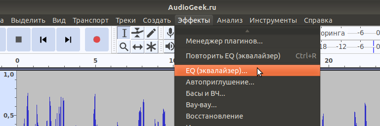

Of course there are also filters such as high-pass and low-pass, but using the equalizer is preferable and lets you do everything those filters do and more.

## The spectrum analyzer

During processing and after it, we will listen to the recording with our ears. At least I really hope so :)

Since, first, we are not professional sound engineers and do not have enough experience, and second, we all hear and listen differently and on different equipment, some objective evaluation is needed.

The spectrum analyzer will serve for that. To use it in Audacity choose ***Analyze → Plot Spectrum***.

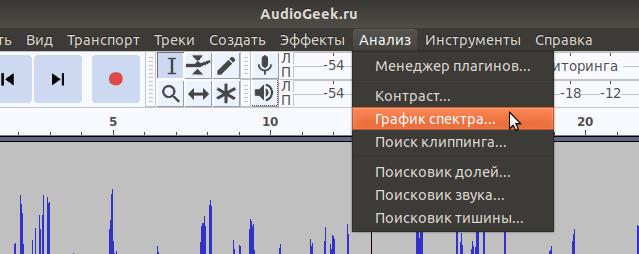

Let us see what the spectrum plot of the recording above looks like:

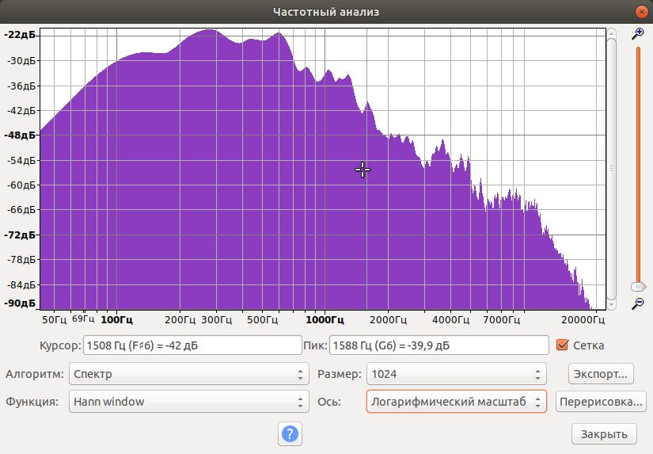

> *Simply put, the spectrum plot shows the loudness (intensity) of sound at each particular frequency. The frequencies are marked under the plot, and the left axis shows intensity in decibels. Sound is conventionally measured from 0 dB, so all values are negative. The same goes for the equalizer.*

### What else is interesting in this window?

In principle we are interested only in specific frequencies and their level. If you hover the mouse over the plot, the Cursor box shows the frequency under your cursor. The Peak box shows the frequency of the nearest peak.

Besides the frequency, these boxes show some other data. For example, the Cursor box in the screenshot contains an entry of the form

**1508 Hz (F#6) = −42 dB**

Here **1508 Hz** is the frequency and **−42 dB** is its intensity. The entry **F#6** means this is the note **F-sharp of the sixth octave**.

Well, so we have got acquainted with the spectrum analyzer in general terms. Now let us move on to using it.

## Equalization: removing unnecessary frequencies

First, remove the unnecessary frequencies.

For a voice recording you can almost always cut everything above 7–8 kHz completely. There is no voice there anymore, but there is all sorts of hissy noise. So select the recording, go to the equalizer and do roughly the following:

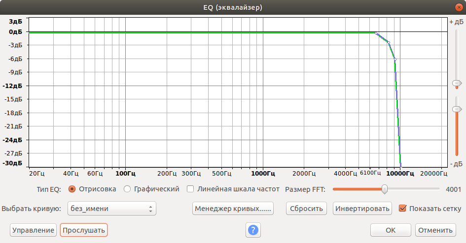

I usually round off the cut region a little. That emulates an analog equalizer and sounds more natural. Choose the cutoff by ear. The main thing is that the voice stays natural.

> *Lowering the level by 3 dB corresponds to a reduction of volume by about a third, and lowering by 6 dB sounds twice as quiet to the ear. If you need to cut some frequencies strongly, 30–40 dB of attenuation is enough in most cases.*

Click OK and open Plot Spectrum again:

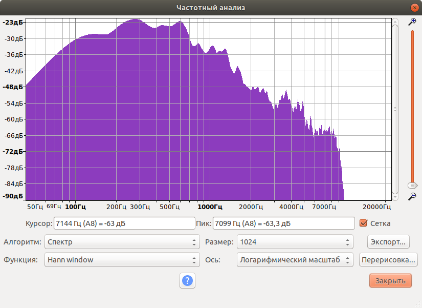

As we can see, the right-hand part has been noticeably cut. By ear the recording became somewhat cleaner and the high-frequency hiss disappeared.

Great, now let us move on to the low frequencies. Speech does not need frequencies below 60–100 Hz. They usually appear when the microphone is close to the mouth, because of the exhaled air. Either way, we do the same operation for the low frequencies.

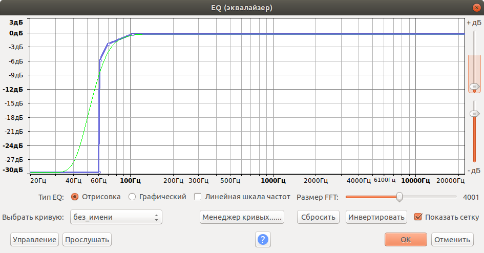

As you can see, a green line has now appeared on the equalizer. It shows how the signal will actually be processed.

> *The steepness of the cut can be adjusted with the Length of filter slider in the equalizer window.*

Look at the spectrum again:

The spectrum changed little because frequencies below 40 Hz are not displayed here.

> But it is still very much worth cutting the lows! You never know where your recording will be played, and if it is played through a subwoofer, especially in a car, there can be quite noticeable rumbling at the very lowest frequencies.

**Great, we have got rid of the excess. Now let us move on to balancing individual frequencies.**

## Equalizing by frequency

### Muddiness

If the voice sounds muddy, you can get rid of it by lowering the frequencies of **200–500 Hz** by 3–6 dB.

The spectrum clearly shows peaks at about 270 and 600 Hz. Let us lower them and the area between them, for example like this:

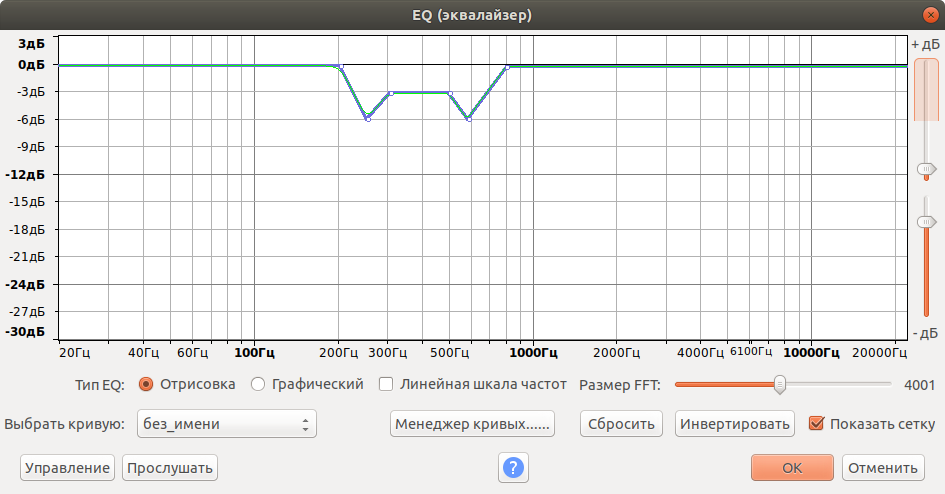

And again let us look at the signal spectrum:

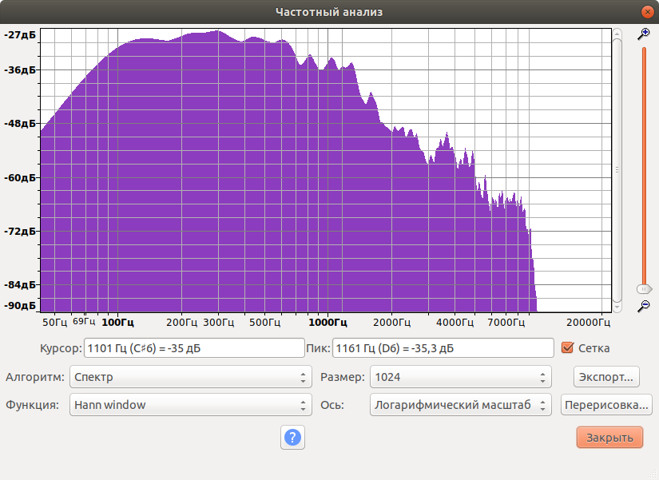

As we can see, the unevenness has noticeably smoothed out and speech has become more intelligible. You can reduce it even more, but here it is better to trust your ears rather than your eyes.

> In fact you do not have to aim for a perfectly straight line on the spectrum plot. What matters is simply to get rid of strong peaks. It is quite likely that on some headphones that frequency will also turn out to be raised, and listening to the recording will be uncomfortable.

### Sibilance

Another common problem is hissing, ringing sounds. It shows up on the letters S, Ts, Sh... There are no obvious problems in this recording, but they usually lie in the frequency range of **4 to 7 kHz**.

In the spectrum above you can see two small peaks around 3.5 kHz and a double peak at 4.7 kHz. You can slightly tame them with the equalizer:

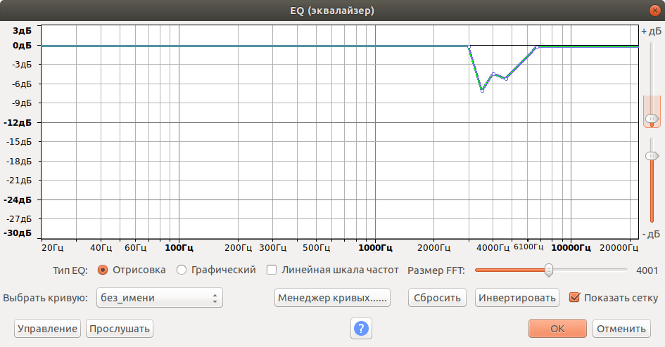

And the spectrum again:

### Horn-like sound

The most audible and informative range of human speech is **500 Hz to 2–3 kHz**. The frequencies around **1 kHz** especially affect perception.

If there is a noticeable peak in this range, you get the feeling that the voice is coming through a megaphone. If there is a dip, the voice will sound very unnatural.

In general you can lower these frequencies a little, so the voice tires the listener less. That is quite relevant for YouTube, for example.

You can do it like this:

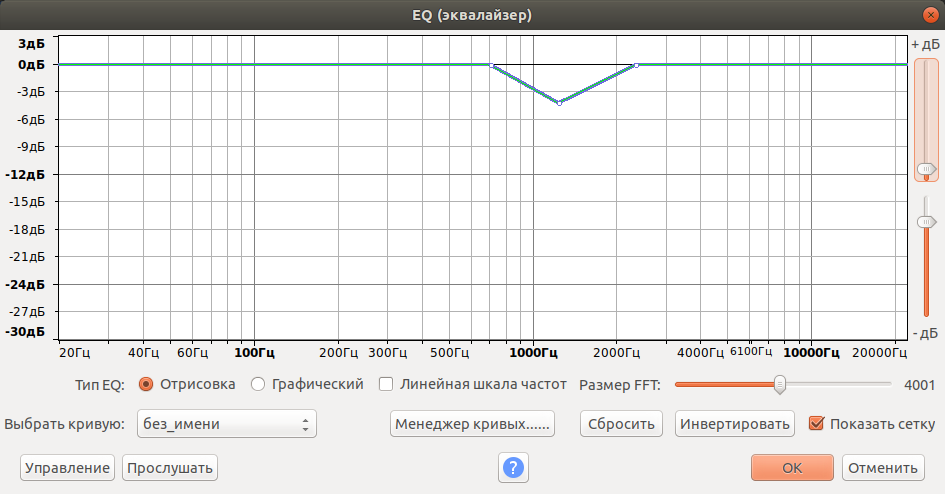

And on the spectrum it will look like this:

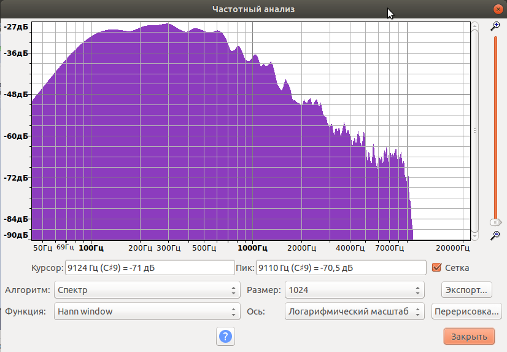

## Equalization: overall frequency balance

**Great, we have covered all the individual points!** In principle you do not have to poke at the spectrum analyzer this meticulously at every step. It is just a tool for judging how even the recording is.

> Now let us forget about the spectrum and just listen to the recording. It is even better to do that with different headphones.

Now it is time for the overall balance. The recording may be too bassy, or conversely the high frequencies may dominate. In that case you can do the following:

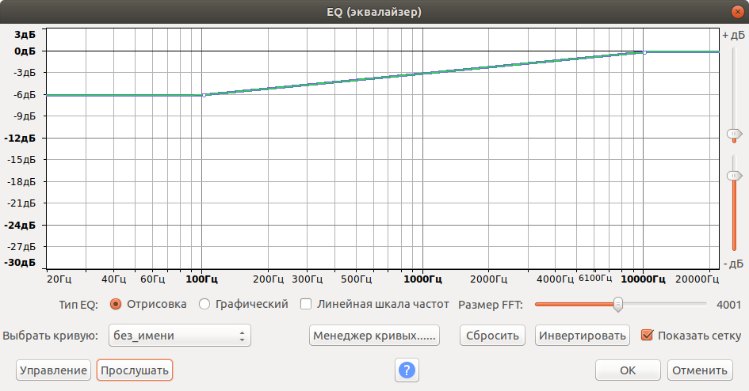

Or raise or lower a specific range that raises doubts:

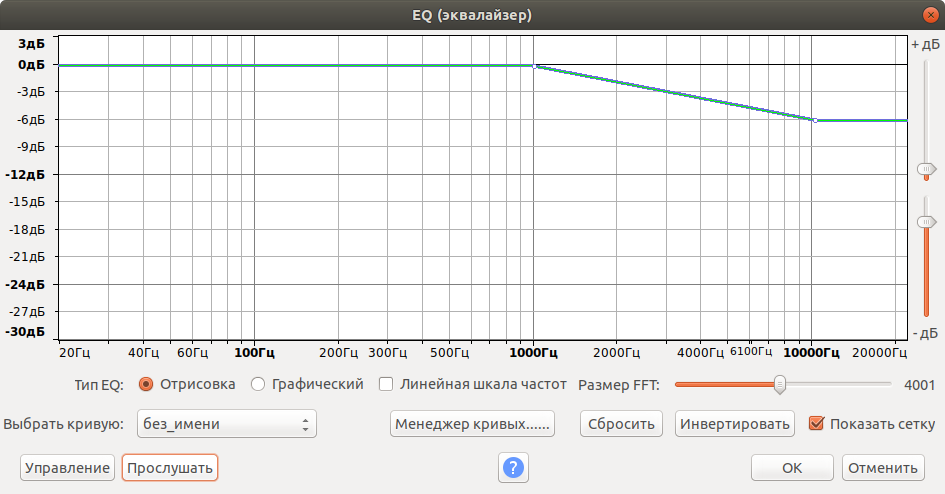

## Saving an equalizer preset

As said at the beginning of the article, all of these actions can be done at once by drawing, for example, an equalizer curve like this:

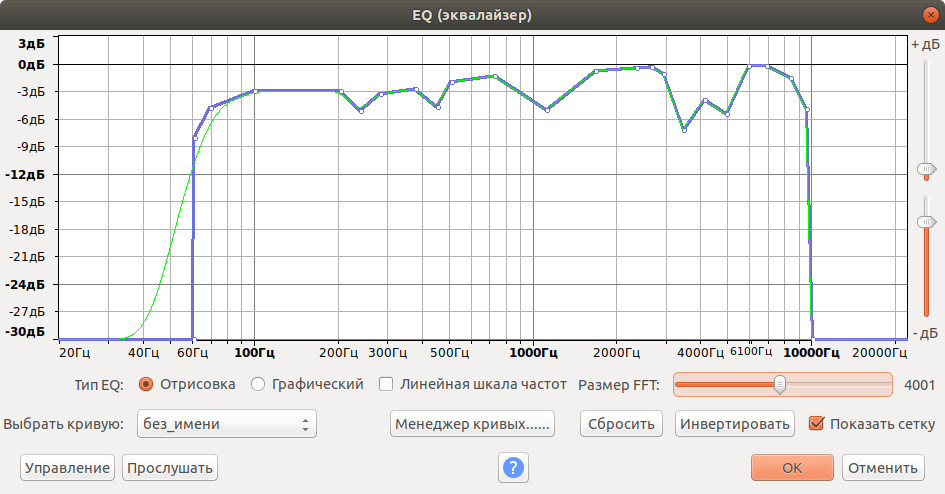

It can even be saved by clicking ***Manage → Save Preset*** and entering the preset name you want.

But in practice it is more effective to equalize each recording separately. It is impossible to create a universal curve, even for one specific microphone.

## Volume level

You have probably noticed that I only ever lower levels on the equalizer and never raise frequencies above 0 dB. As a result the recording became noticeably quieter.

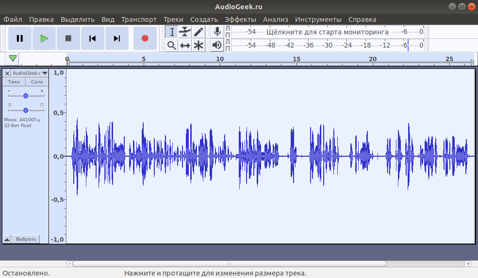

> **This is an important point, because if you boost some frequencies, it may lead to clipping of some parts of the recording. Keep that in mind.**

To raise the volume it is enough to simply Normalize the recording:

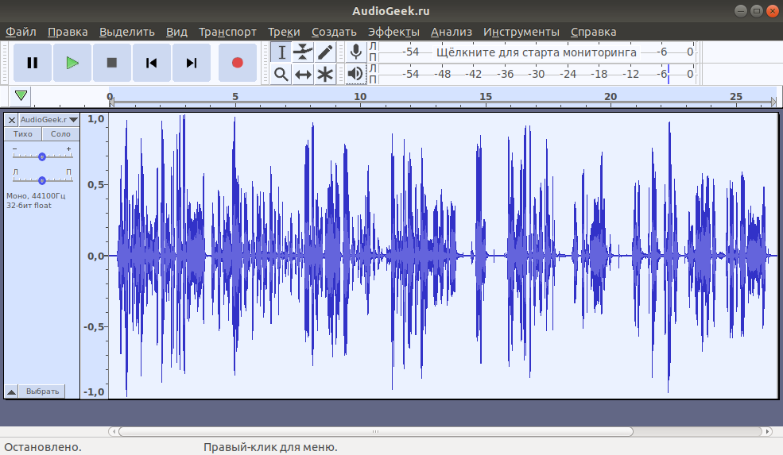

## Conclusion

I think you now have an idea of how to work with the equalizer and the spectrum analyzer. And equalizing a recording is no longer difficult.

**If you have questions, do not hesitate to write them in the comments. And not only questions :)**

> The main thing is always to go by ear first. Everything else is only a tool to help with the work.

**Well, that is all from me, good sound to everyone!**

*Originally written for [AudioGeek.ru](https://audiogeek.ru). Translated from Russian.*
