[English](./README.md) | **Русский**

# Эквализация записи голоса в Audacity

**Рубрики:** Обработка звука  
**Метки:** Audacity, качество звука, обработка звука  
**Оригинал:** https://audiogeek.ru/voice-eq-audacity/

---

Разные микрофоны очень по разному записывают звук. Даже один и тот же микрофон, подключенный к разным устройствам будет немного по разному писать одинаковый звук. Рассматривать почему так происходит мы не будем, а вместо этого рассмотрим, как может быть проведена эквализация готовой записи.

## **Эквализация записи голоса**

Не хотелось бы превращать эту статью в бесконечную простыню текста, все равно нельзя объять необъятное. Поэтому рассмотрим основные моменты и общие рекомендации на примере эквализации записи голоса. Зная их вам не составит труда опытным путем добиться желаемого результата для любой записи.
Все работы, как и обычно, будут проделаны в простом и бесплатном Audacity. Каждый шаг будет показан и объяснен отдельно. На самом деле их можно объединить в один проход. Но это будет сложнее для понимания.
> Эквализацию, как любую другую обработку звука, лучше производить в наушниках. Если ваши любимые наушники как на зло сломались в самый неподходящий момент, то починить их на скорую руку поможет статья: ***[Ремонт наушников голыми руками, без паяльника!](../remont-naushnikov-bez-payalnika/)***

## **Эквалайзер**

Открываем программу и закидываем в нее запись:
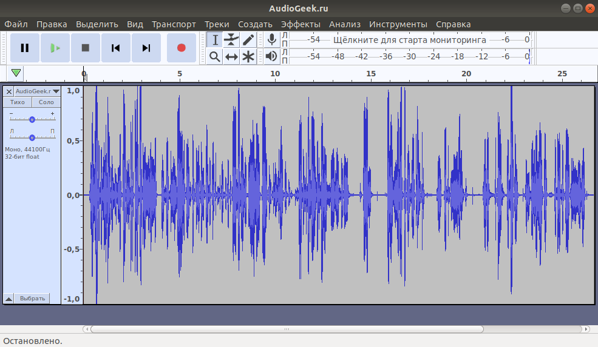
> Запись уже была предварительно очищена от шума и выровнена по громкости. В целом эту статью можно рассматривать как дополнение к статье ***[Как быстро и просто обработать запись голоса в Audacity](../kak-obrabotat-golos-audacity/)***, в которой вы найдете все остальные необходимые действия.

Для эквализации в Audacity, как в любом другом аудио-редакторе, есть эквалайзер. Логично, не правда ли?)
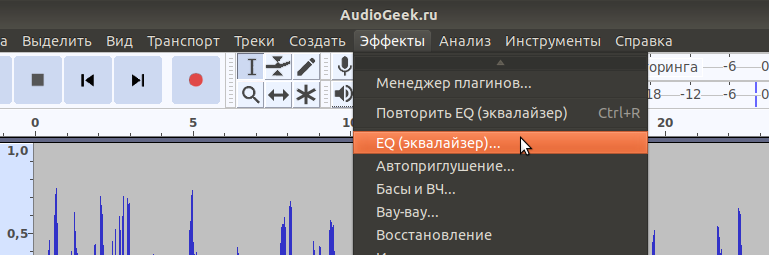
Конечно есть еще фильтры типа Фильтр ВЧ и НЧ, но использование эквалайзера предпочтительнее и позволяет делать гораздо все и даже больше любых фильтров.

## **Анализатор спектра**

В процессе обработки и после нее, запись мы будем слушать ушами. По крайне мере я на это очень надеюсь)
Так как во первых мы не профессиональные звукооператоры и не имеем достаточного опыта, а во вторых слышим и слушаем по-разному и на разном оборудовании, то следовательно необходима какая-то объективная оценка.
Для этого нам послужит Анализатор спектра. Для того, чтобы воспользоваться анализатором спектра в Audacity выбираем ***Анализ→График спектра***.
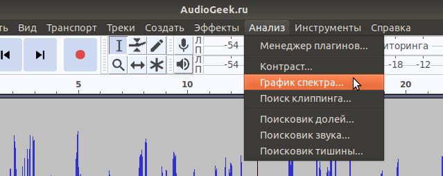
Глянем, как выглядит график спектра записи показанной выше:
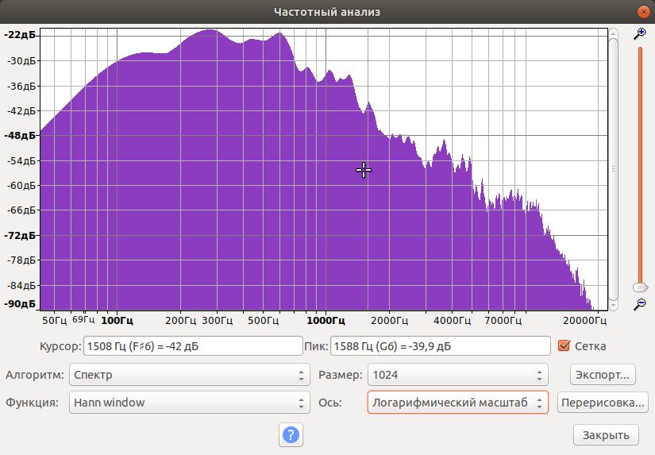
> *Если по-простому - график спектра показывает громкость(интенсивность) звука на каждой конкретной частоте. Снизу под графиком обозначены частоты, а по левой оси отложена интенсивность в деци Беллах. Звук принято отсчитывать от 0 дБ, поэтому все значения отрицательные. Аналогично и на эквалайзере.*

### **Что еще интересного есть в этом окошке?**

В принципе нас интересуют только конкретные частоты и их уровень. Если навести мышкой на график, то в окошке Курсор мы увидим частоту, на которую наведен ваш курсор. А в окошке Пик показывается частота ближайшего пика.
Помимо частоты в этих окошках мы видим еще некоторые данные. Например окошко Курсор, на скриншоте содержит запись вида
**1508 Гц (F#6) = - 42 дБ**
Тут **1508Гц** это частота, а **-42 дБ** это ее интенсивность. А вот запись **F#6** означает, что это нота **Фа диез шестой октавы**. Что означают другие буковки в такой записи нот вы можете найти в статье ***Настройка гитары***.
Что-ж вот мы и ознакомились с анализатором звука в общих чертах, теперь перейдем к его использованию.

## **Эквализация - лишние частоты**

В первую очередь уберем лишние частоты.
Если речь идет о записи голоса, то практически всегда можно полностью урезать частоты выше 7-8 кГц. Голоса там уже нет. Зато есть всякий шипящий шумок. Поэтому выделяем запись, переходим в эквалайзер и делаем примерное следующее:
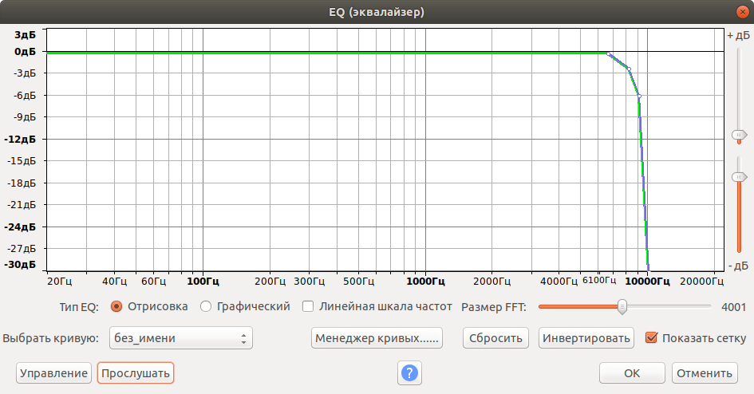
Обычно я немного скругляю область среза. Так это эмулирует аналоговый эквалайзер и звучит естественнее. Частоту среза стоит выбирать ориентируясь на слух. Главное чтобы звучание голоса оставалось естественным.
> *Опускание громкости на 3 дБ соответствует уменьшение громкости в полтора раза, а опускание на 6 дБ - на слух звучит в 2 раза тише. Если нужно сильно вырезать какието частоты то в большинстве случаев хватит подавления на 30-40 дБ.*

Нажимаем ОК и снова заходим в График спектра:
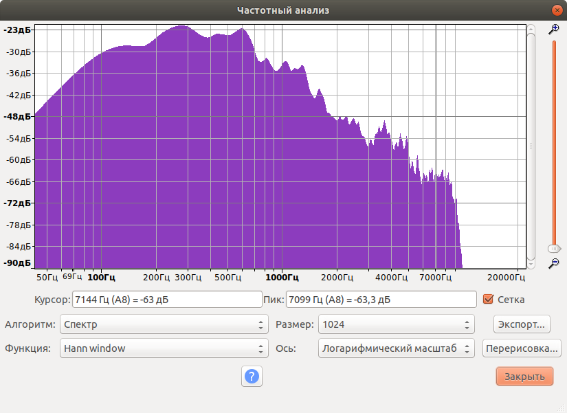
Как видим, правая часть заметно срезалась. На слух же запись стала несколько чище и исчез высокочастотный шумок.
Отлично, теперь перейдем к низким частотам. В речи не нужны частоты ниже 60-100 Гц. Появляются они обычно если микрофон расположен близко ко рту из-за выдыхаемого воздуха. Так или иначе проделываем аналогичную операцию и для низких частот.
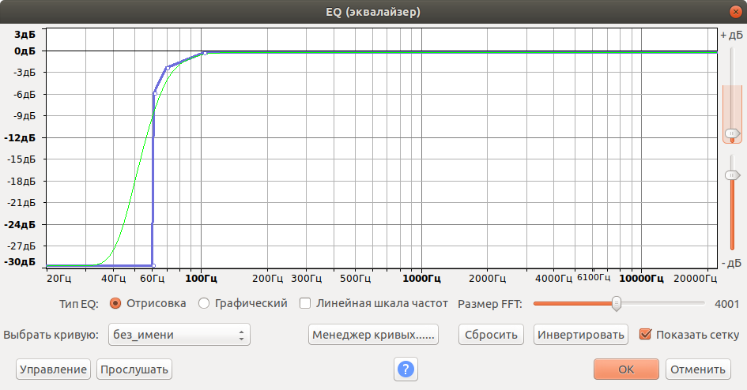
Как видите, на эквалайзере теперь появилась еще и зеленая линия. Она показывает как на самом деле будет обработан сигнал.
> *Крутизну среза можно отрегулировать ползунком Размер FFT в окошке эквалайзера.*

Опять посмотрим на спектр:

Спектр изменился незначительно, потому, что тут не отображаются частоты ниже 40 Гц.
> Но срезать низкие все-равно очень даже стоит! Никогда не знаешь, где будет прослушана ваша запись, а если включить ее на сабвуфере, особенно в машине, то могут быть вполне заметные подгуживания по самым низким частотам.

**Отлично, от лишнего мы избавились, теперь перейдем к выравниванию отдельных частот.**

## **Эквализация по частотам**

### **Бубнение**

Если в голосе наблюдается бубнение, то избавиться от него можно опустив частоты **200-500 Гц** на 3-6 дБ.
На спектре хорошо видны пики на частотах около 270 и 600 Гц. Опустим их и область между ними например вот так:
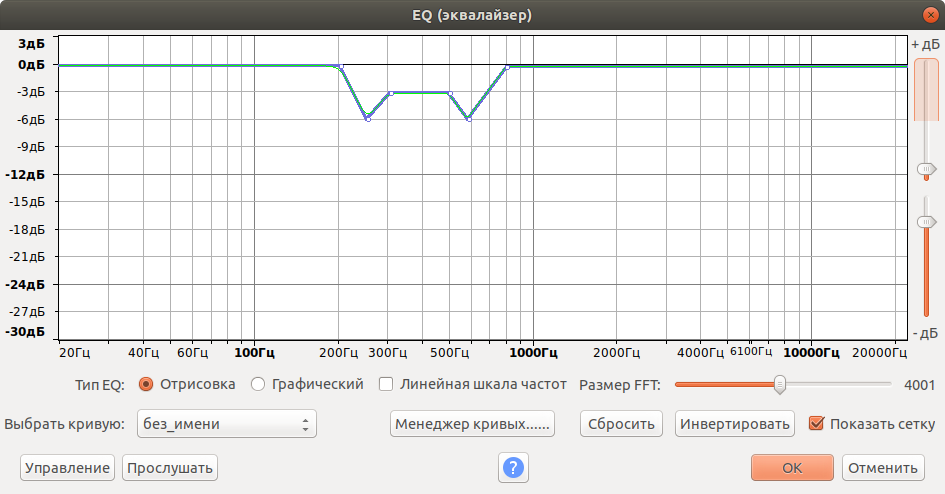
Ну и снова смотрим на спектр сигнала:
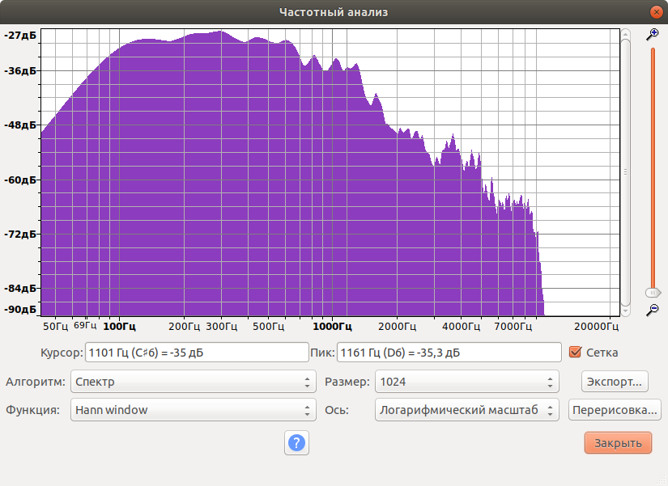
Как видим - неравномерность заметно сгладилась, а речь стала более разборчивой. Можно подавить еще сильнее, но в данном случае лучше верить ушам, а не глазам.
> На самом деле не обязательно стремиться к идеально прямой линии на графике спектра. Важно просто избавиться от сильных пиков. Вполне вероятно, что на каких-то наушниках эта частота также окажется приподнятой и слушать запись будет некомфортно.

### **Шипящие**

Еще одной частой проблемой являются всякие шипяще-звенящие звуки. Проявляется это на буквах С, Ц, Щ..... На данной записи явных проблем не наблюдается, но располагаются они обычно в интервале частот от **4 до 7 кГц**.
На спектре выше видны дне небольших пика в районе 3.5 кГц и сдвоенный пик на 4.7 кГц. Можно слегка загасить их эквалайзером:
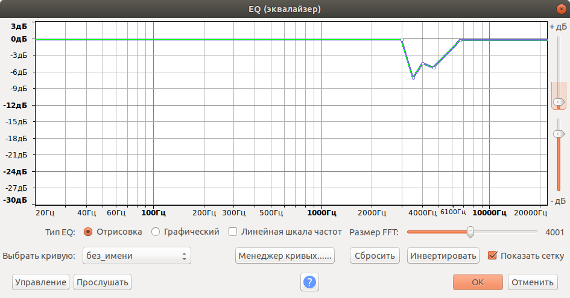
Ну и снова спектр:

### **Рупорность звука**

Самым слышимым и информативным диапазоном человеческой речи является диапазон от **500 Гц до 2-3 кГц**. Особенно влияет на восприятие частоты в районе **1 кГц**.
Если в этом интервале частот будет заметным пик, то возникнет ощущение что голос звучит через рупор. Если же будет провал, то звучание голоса станет очень неестественным.
В целом можно немного опустить эти частоты, так голос будет меньше утомлять слушателя. Что весьма актуально например для Ютуба.
Сделать это можно например вот так:
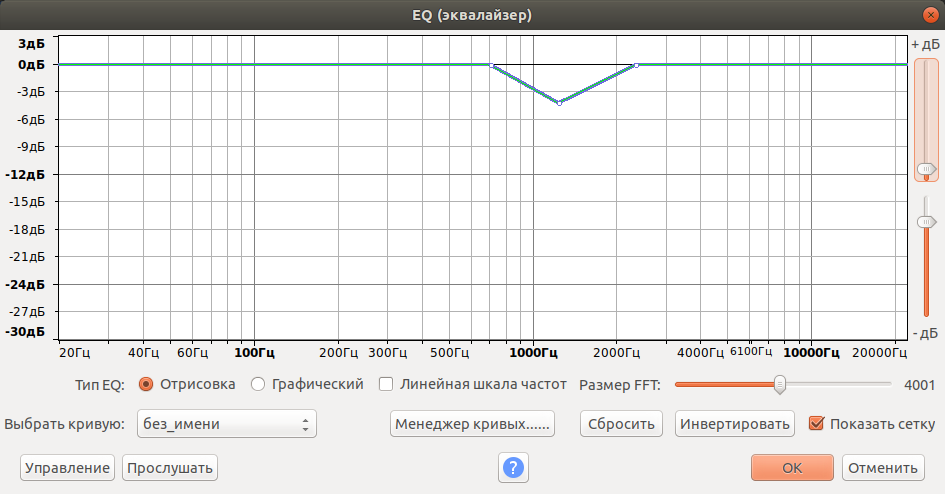
Ну и на спектре это отразится следующим образом:
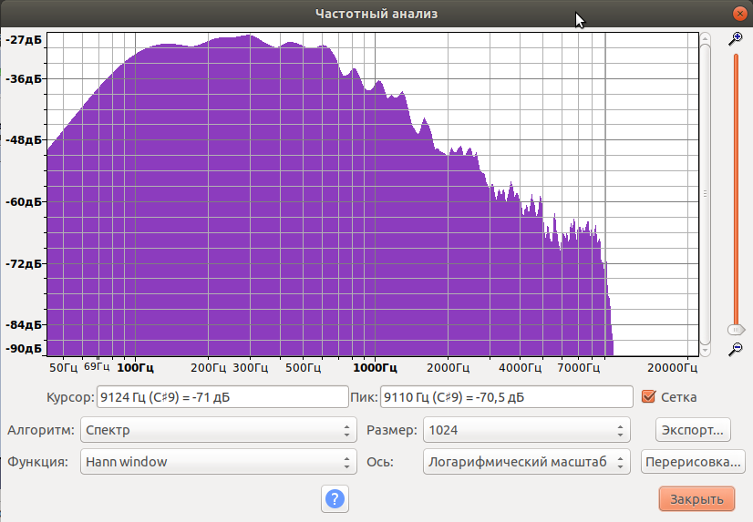

## **Эквализация - общий частотный баланс записи**

**Отлично все отдельные моменты мы рассмотрели!** В принципе не обязательно так дотошно тыкать в анализатор спектра на каждом шаге. Он просто инструмент, позволяющий оценить ровность записи.
> Теперь забудем про спектр и просто послушаем запись. Будет даже лучше, если сделать это на других наушниках.

Теперь пришел черед общего баланса. Возможно что запись слишком басовита, либо же наоборот преобладают высокие частоты. В таком случае можно поступить следующим образом:
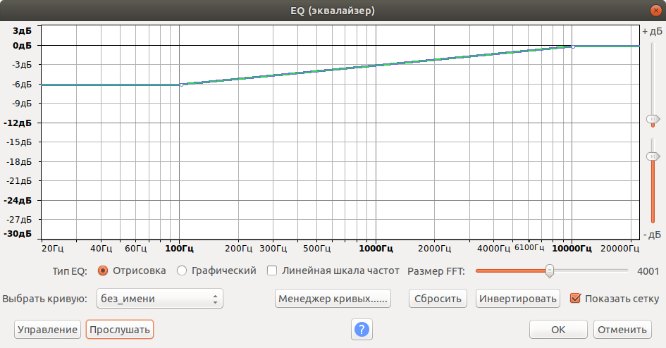
Или же поднять/опустить какой-то конкретный диапазон, вызывающий сомнения:
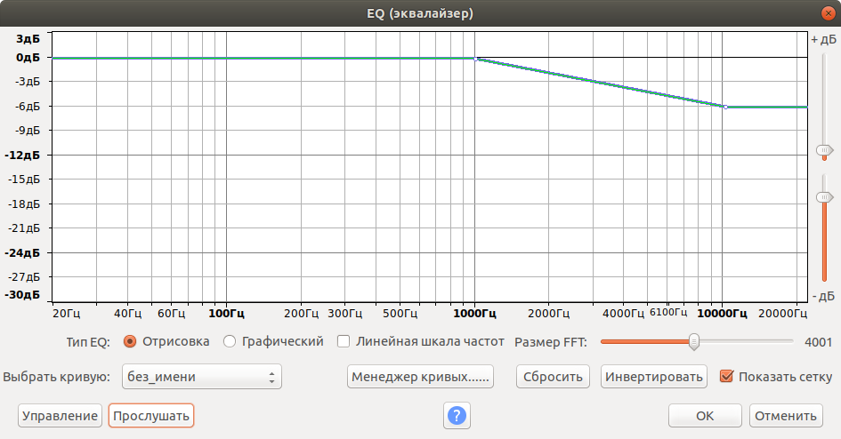

## **Сохранение пресета эквалайзера**

Как было сказано в начале статьи, все действия можно сотворить сразу, нарисовав например такой эквалайзер:
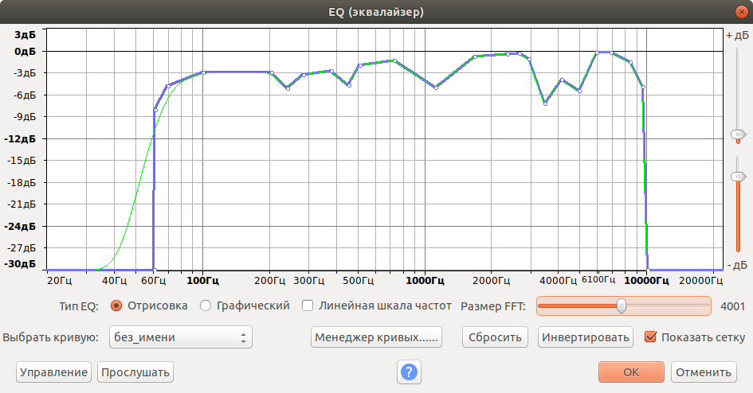
Его даже можно сохранить нажав ***Управление→Сохранить настройки*** и задав желаемое имя для пресета.
Но на практике эффективнее проводить отдельную эквализацию для каждой конкретной записи. Создать универсальную кривую даже для одного конкретного микрофона невозможно.

## **Уровень громкости**

Наверное вы заметили, что я всегда только опускаю на эквалайзере, но никогда не поднимаю частоты на уровень выше 0дБ. В результате запись стала заметно тише.
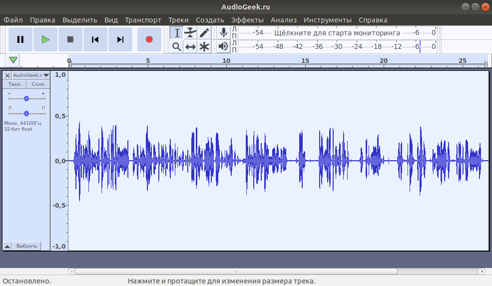
> **Это важный момент, т.к. если усиливать какие либо частоты, то может получится, что это приведет к клиппингу (подрезанию) некоторых участков записи. Имейте это ввиду.**

Для того чтобы поднять громкость достаточно просто произвести Нормировку записи:
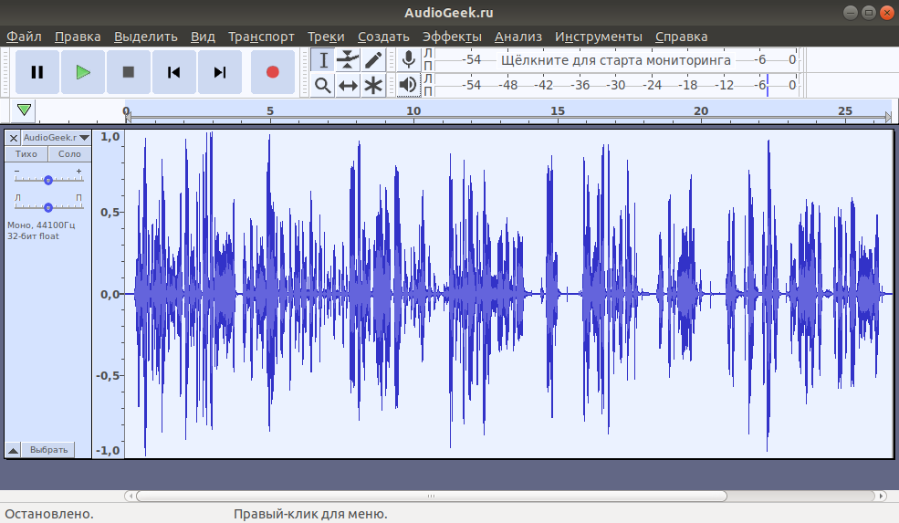

## **Заключение**

Думаю, что теперь вы имеете представление о том, как работать с эквалайзером и анализатором спектра. Ну а эквализация записи больше не представляет сложности.
**Если остались вопросы - не стесняйтесь писать их в комментариях. Да и не только вопросы)**
> Главное - всегда ориентируйтесь в первую очередь на слух. А все остальное - лишь инструменты, помогающие в работе.

**Что-ж, на этом у меня все, хорошего всем звука!**

***Материал подготовлен исключительно для сайта* [AudioGeek.ru](https://github.com/SkyTrip-13/AudioGeek)**
