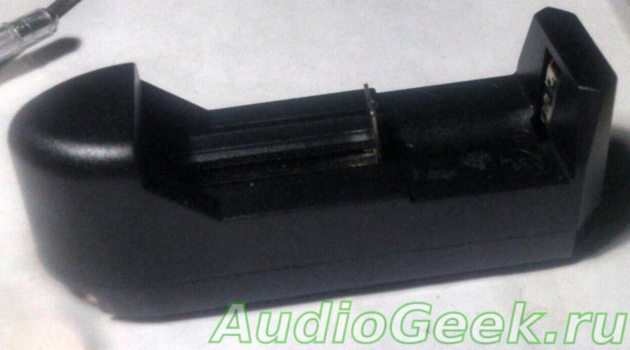
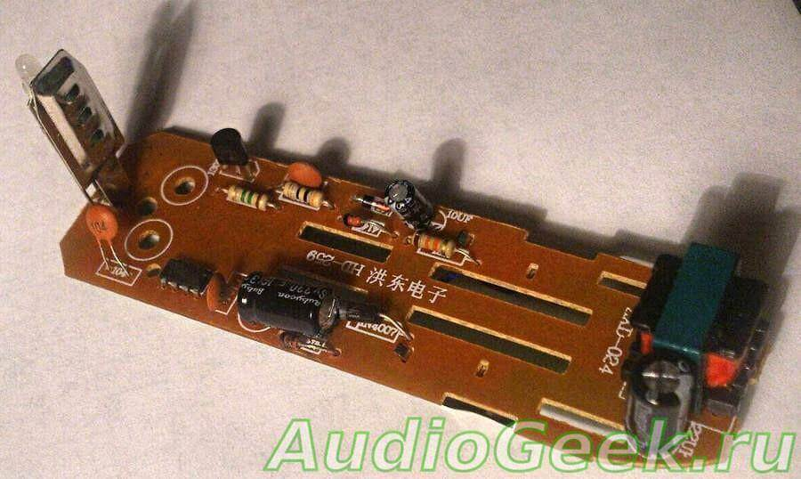
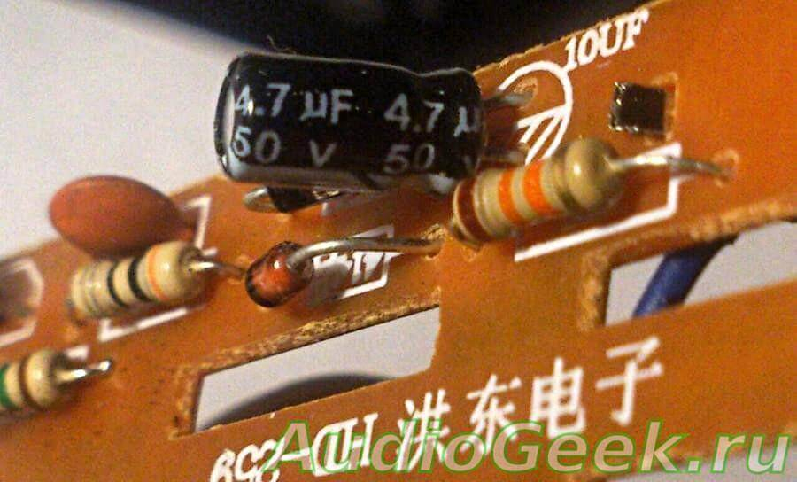
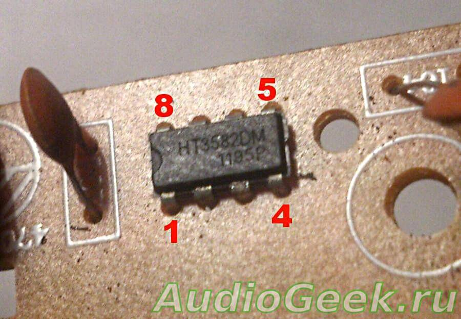
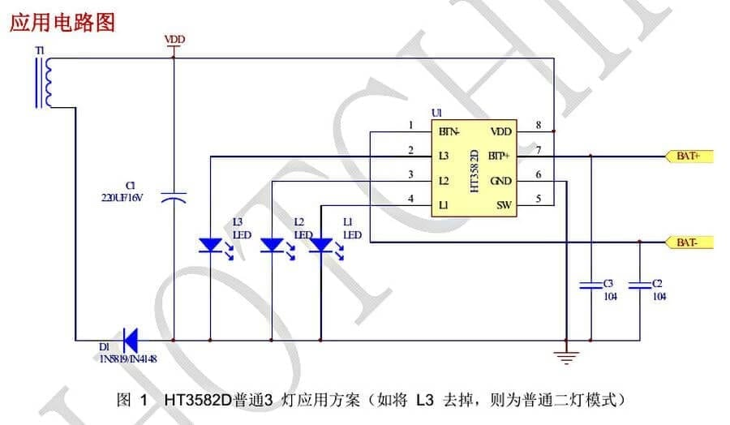
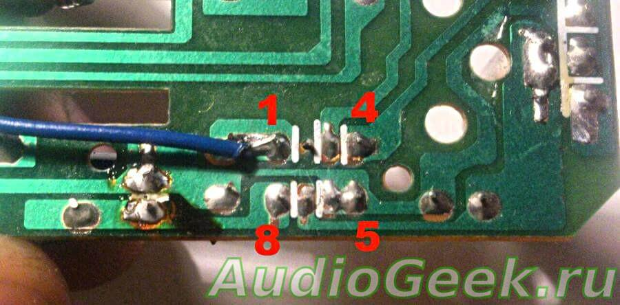
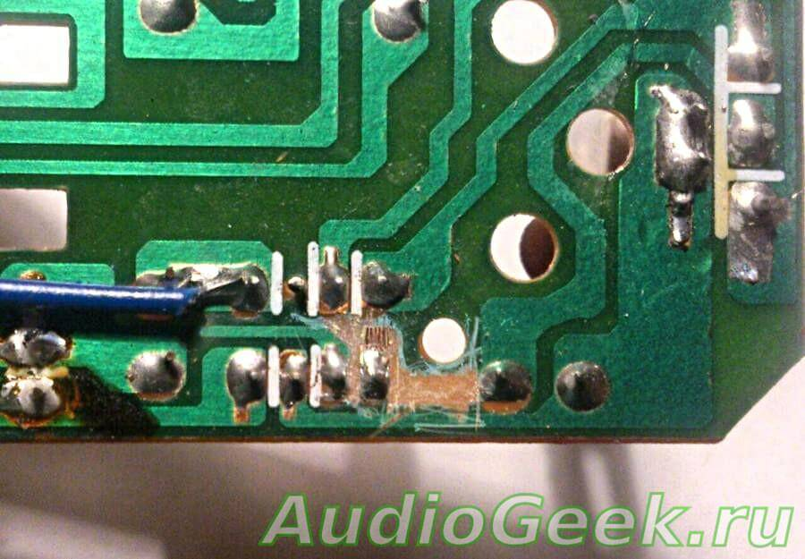
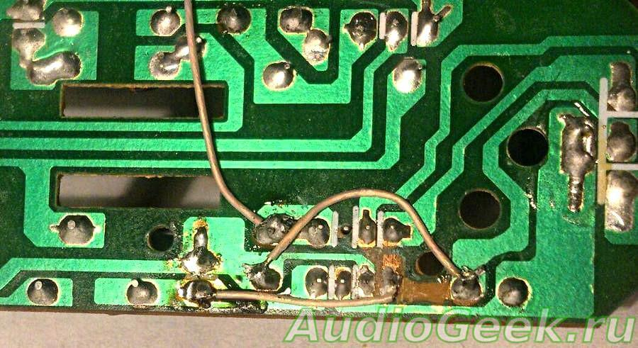
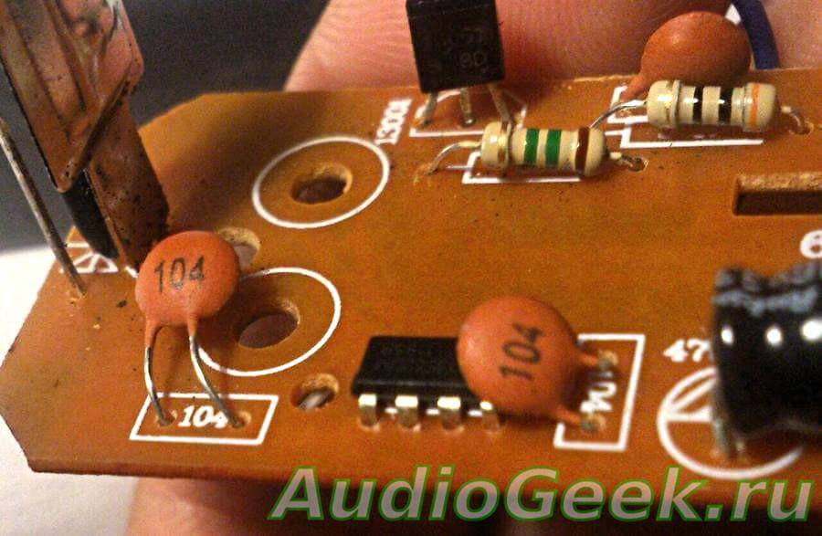
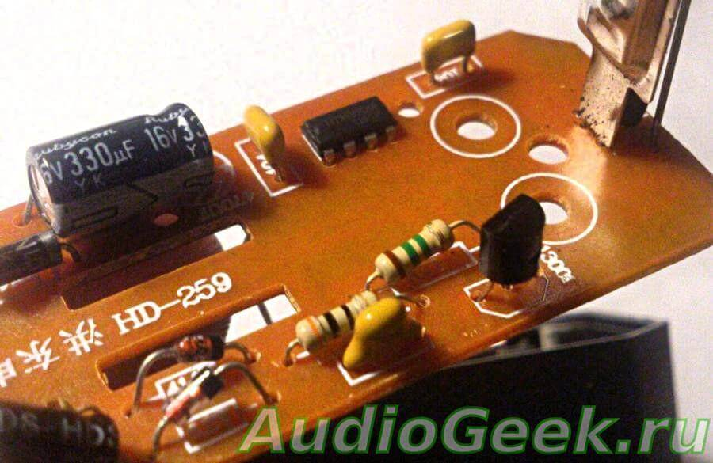

[Русский](./README.ru.md) | **English**

# An 18650 battery charger: how to raise the charge current of a lithium cell

**Category:** Repair and testing  
**Tags:** power supply, DIY  
**Original:** https://audiogeek.ru/zaryadnoe-ustroystvo-18650/

---

Lithium batteries have long since conquered the world; all that remains is to charge them on time. Charging is what this article is about, or rather how to raise the charge current of a lithium battery charger. This applies both to universal "frog" chargers and to most chargers for 18650-type cells. How to make an 18650 charger deliver its maximum in 10 minutes.
Out of necessity I had to buy a charger for 18650 lithium cells. And all would be well, but even overnight it could not properly charge a 2500 mAh cell. Such chargers are very popular and widespread thanks to their low price.
> **At the moment I use ready-made Chinese modules to charge lithium cells. Such modules cost about 30 cents each. These modules and their characteristics are covered in detail in the article *[A smart lithium battery charge controller: the TP4056 module](../kontroller-zaryada-li-ion-modul/)*. I even made a separate YouTube video about these modules. I recommend watching it, because with such modules you can safely charge a 3000 mAh cell in less than 3 hours.**

> ▶ **[Watch the video on YouTube](https://www.youtube.com/watch?v=Ow8v4vfCHpQ)**

## How to raise the charge current of a Chinese lithium cell charger

Back to the Chinese wonder. It is clear that the matter is murky: the charger gives too small a current. The label claimed a charge current of 450 mA. In practice that means the charge time of my cell should be about 6–7 hours. But in fact it could not manage its job even in 10. Which is not even surprising given the country of manufacture and a price of under $2.

Before the next act of extravagance and buying a proper charger, the idea came to dissect the device and "solder in the missing parts" into this Chinese wonder.

## Opening up the lithium cell charger

The autopsy showed that all the parts are in place. That slightly surprised me, but looking closer it turned out that not all of them are what they should be. The first thing that caught the eye was the mismatch between the capacitance on the electrolytic capacitor's label and the marking on the board:

As you can see, the electrolytic capacitor should be 10 µF (10uF on the board), but a 4.7 µF one is fitted. In general that is not such a critical problem. It would be better, of course, to fit the required value, but I did not have one. The installed capacitor is marked 50 V. It hardly really is that high. But when replacing, it is better to fit capacitors for the same or a higher voltage.
The same trouble applies to the second electrolytic. It says 470 µF, but 100 is fitted. It is installed at the output and rated for 16 volts. Well, I replaced it with a 330 µF/16 V one I found. At first I thought of fitting 470 µF, but it did not fit.
The capacitor is of course good, and the larger the capacitance the better the smoothing of the output voltage, but it will not change anything radically. So next I decided to dig into which battery charge controller is in there.

## The HT3582 chip: a lithium cell charge controller

The HT3582 is a very common battery charge controller that appears in practically every "frog" and Chinese charger. The purpose of the HT3582 is to control the charging process of a lithium cell.
I had no particular desire to delve into the documentation, and I am not strong in Chinese anyway. But the main thing that caught my eye was two possible connection schemes.
As it turned out, the chip has a special pin that determines the battery charge current.

More precisely, it is pin 5, which can be connected in two ways (for convenience the pin numbers are labeled in red):

- Tied to ground (the supply negative): the output current is up to **300 mA**
- Connected to the supply rail: the output current is up to **450 mA**

As you have probably guessed, the charger originally implemented the uninteresting first variant. So I decided to implement the second and raise the output current. A matter of 10 minutes. Here is the charge controller circuit of interest from the datasheet:

I have great doubts about the current values given. Several datasheets can be found and the figures differ everywhere. But connecting that pin to the supply rail will in any case make the chip work harder.

## Changing the connection to raise the charge current

Pin 5 was tied to the ground arriving at the neighboring pin 6. Further on, the ground track goes to a small capacitor and an LED.

To implement the plan, the tracks leading off in both directions from pin 5 must be cut.

It looks scary, but that does not matter :)
Next, join the cut parts of the track with a piece of wire, bypassing pin 5. Pin 5 of the chip is conveniently soldered with a wire to the positive terminal of the 330 µF electrolytic I just re-soldered.

The wire going up is the one going to the battery's negative contact.
> **By the way, notice that the chip's second pin is left hanging in the air. The datasheet circuit prescribes an LED for it, which is simply not there.**

Hooray! Now the chip will try to deliver everything it is capable of, which cannot fail to please :)

## Terrible capacitors

While searching for information on the chip, I came across an entertaining article about repairing a similar charger. I confess honestly that this is where I spotted the mention of the all-powerful pin 5 of the chip, for which special thanks to the author and a link to [his article](http://elwo.ru/publ/remont/remont_zarjadnogo_dlja_litievykh_akkumuljatorov/3-1-0-981?Me8HcIN).
The author did not connect pin 5 to the charger's supply rail, but he clearly demonstrated the Chinese manufacturers' blatant fakery with small ceramic capacitors whose parameters leave much to be desired. Their capacitance is several times lower than what is written on them. I am talking about the three orange ceramic "pillows":

0.1 µF capacitors are in great shortage with me, going like hot cakes, so I soldered in yellow multilayer 0.22 µF ones. Although the capacitance is not ideal in value, you can at least be sure of it ))

## Happy ending

That is where the handiwork ended. All through the process an intrusive thought kept spinning that I would plug the charger into the mains now and find out what a Chinese fire dragon looks like. But nothing even smoked, and the charger worked as it should...

What is more, before the modification the LED simply glowed red during charging, and now it blinks from red to green. There is an Easter egg from our Chinese brother for you.
Still, I recommend ripping out all the electronics and using this charger only as a case. And it is better to build an 18650 charger on ***[charge control modules](../kontroller-zaryada-li-ion-modul/),*** with a video about them at the beginning of the article. I recommend watching that video; I tried very hard to make it entertaining and educational :)

*Originally written for [AudioGeek.ru](https://audiogeek.ru). Translated from Russian.*
