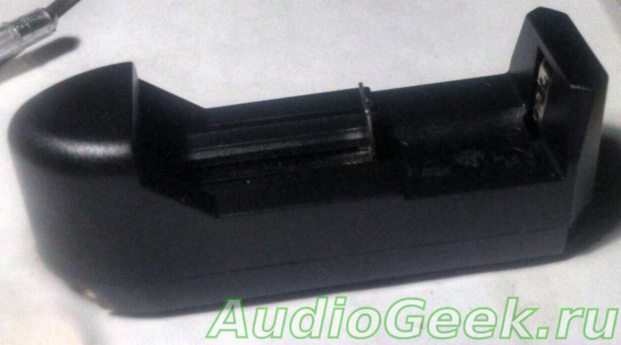
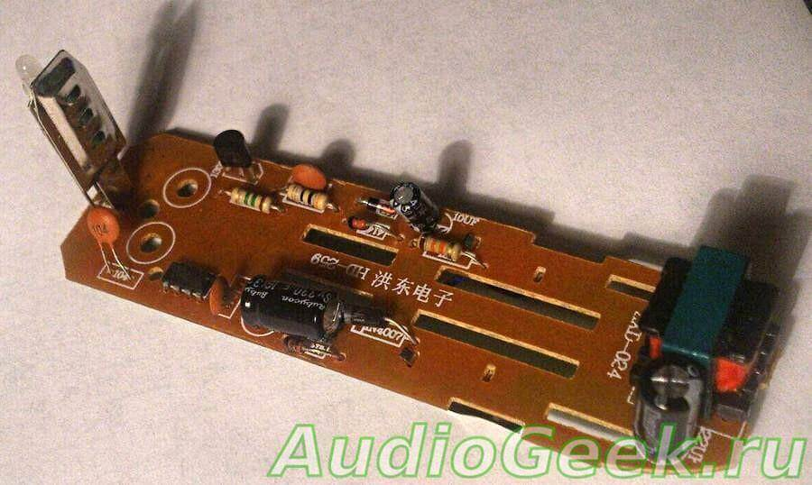
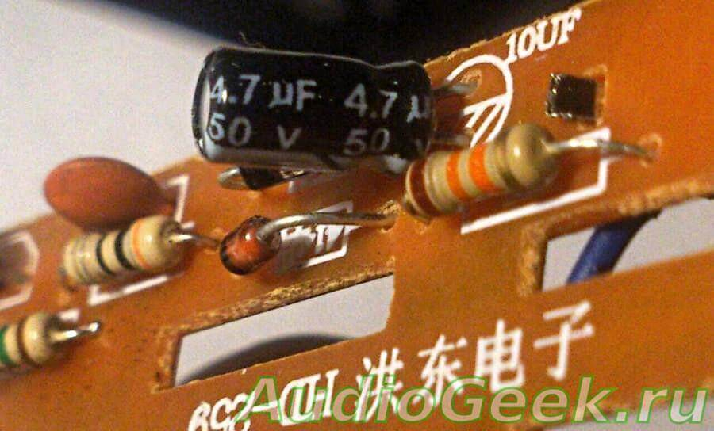
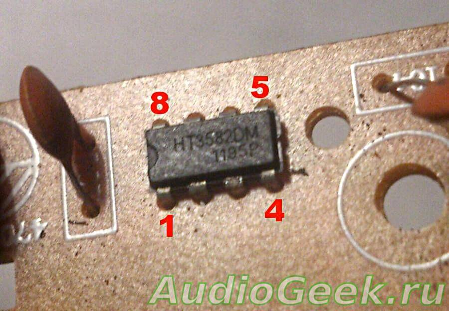
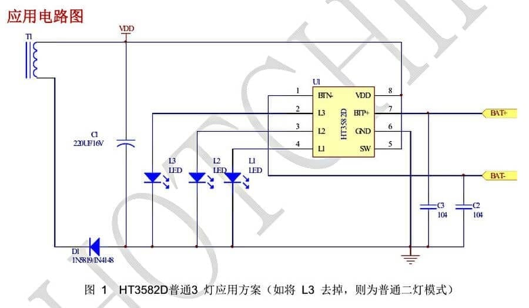
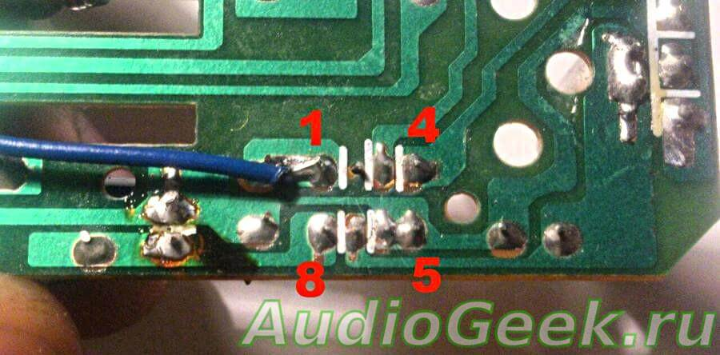
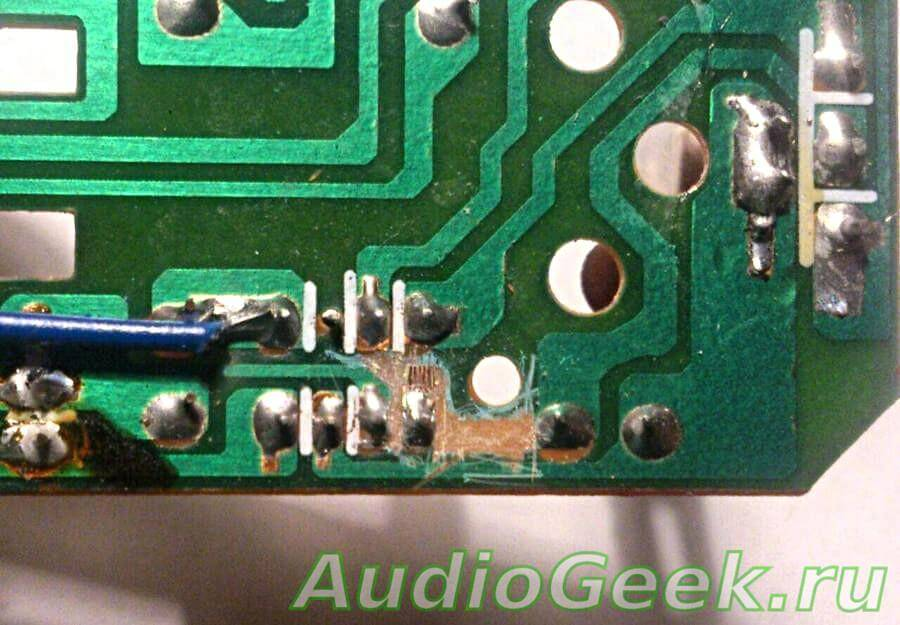
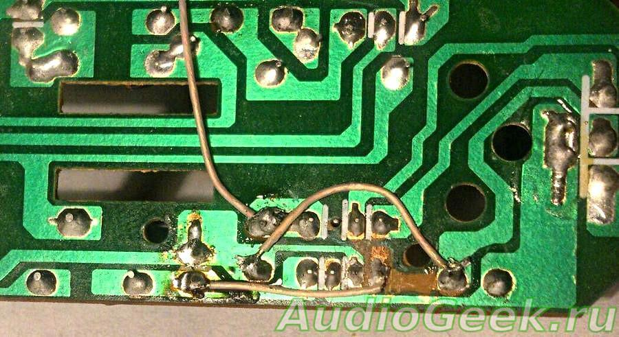
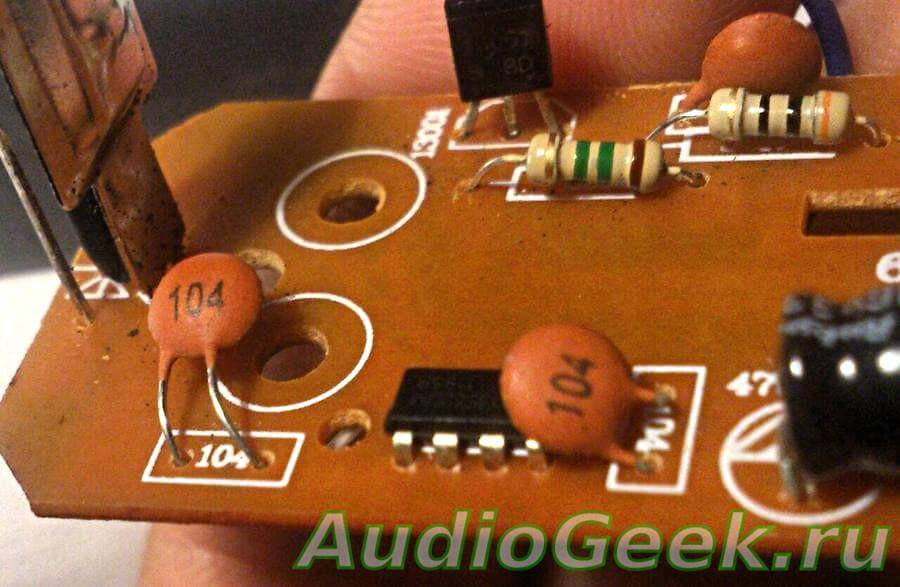
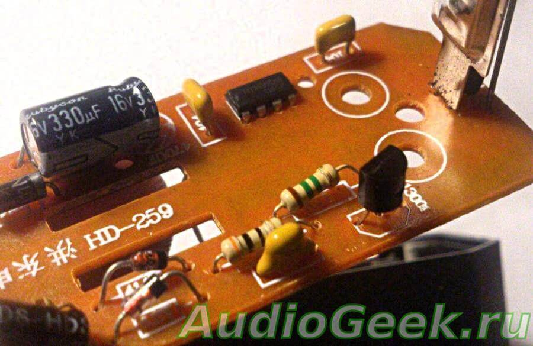

[English](./README.md) | **Русский**

# Зарядное устройство 18650 - как повысить ток заряда литиевого аккумулятора

**Рубрики:** Ремонт и проверка техники  
**Метки:** источник питания, своими руками  
**Оригинал:** https://audiogeek.ru/zaryadnoe-ustroystvo-18650/

---

Литиевые аккумуляторы уже давно захватили мир, осталось их только вовремя заряжать. О зарядке сегодня и пойдет речь, а точнее о том, как повысить ток заряда у зарядки для литиевого аккумуляторов. Данный вопрос относится как к лягушкам, так и большинству  зарядок для аккумуляторов типа 18650. Как заставить выдать максимум зарядное устройство 18650 за 10 минут.
По воле нужды пришлось купить зарядное устройство для зарядки литиевого аккумулятора формата 18650. И все бы ничего, но она даже за целую ночь не могла нормально зарядить емкость аккумулятора в 2500 мАч. Подобные зарядки весьма популярны и распространены благодаря своей низкой стоимости.
> **В настоящий момент для зарядки литиевых аккумуляторов я использую готовые китайские модули. Стоят такие модули по 30 центов за штуку. Эти модули и их характеристики подробно рассмотрены в статье  *[Умный контроллер заряда литиевых аккумуляторов - модуль на tp4056](../kontroller-zaryada-li-ion-modul/)*. Более того я даже снял отдельный ролик для Ютуба про эти модули. Рекомендую его посмотреть, ведь такими модулями можно безопасно зарядить аккумулятор емкостью 3000 мА\*ч менее чем за 3 часа.**

> ▶ **[Смотреть видео на YouTube](https://www.youtube.com/watch?v=Ow8v4vfCHpQ)**

## Как повысить ток заряда литиевого аккумулятора китайской зарядки

Вернемся к китайскому чуду. Дело ясное, что дело темное - зарядка дает слишком маленький ток. Этикетка заявляла ток заряда в 450 мА. На практике это означает, что время заряда моего аккумулятора должно составлять порядка 6-7 часов. Но по факту она и за 10 не управлялась со своей работой. Что даже не удивительно учитывая страну производства и стоимость менее 2$.

Перед очередным расточительством и покупкой нормального зарядного устройства заинтересовала мысль препарировать девайс и “впаять не хватающих деталей” в это китайское чудо.

## Вскрытие зарядного устройства литиевого аккумулятора

Вскрытие показало, что все детали на месте. Меня это слегка удивило, но приглядевшись внимательнее выяснилось, что не все они такие какими должны быть. Первым делом в глаза бросилось несовпадение емкости на этикетке электролитического конденсатора и надпись на плате:

Как видно, емкость электролита должна быть 10мкФ (10uF на плате), а по факту стоит 4.7 мкФ. В общем-то это не такая уж критическая проблема. Лучше бы, конечно, установить требуемую величину, но у меня ее не нашлось. На установленном конденсаторе указанно напряжение в 50 В. Врядли оно там действительно такое большое. Но при замене лучше устанавливать конденсаторы на аналогичное или большее напряжение
Аналогичная беда и со вторым электролитом. Указанно 470 мкФ, а стоит 100. Он установлен на выходе и рассчитан на напряжение в 16 вольт. Что-ж, заменил его на найденный 330мкФ/16В. Сначала была мысль установить 470 мкФ, но он не влез.
Конденсатор это конечно хорошо, чем больше емкость тем лучше сглаживание выходного напряжения, но кардинально это ничего не изменит. Поэтому далее было решено покопаться на тему какой тут контроллер заряда аккумулятора.

## Микросхема HT3582 - контроллер заряда литиевых аккумуляторов

Микросхема HT3582 - очень распространенный контроллер заряда аккумулятора, который фигурирует чуть ли не в каждой лягушке и китайской зарядке. Назначение микросхемы HT3582 заключается в контроле процесса заряда литиевого аккумулятора.
Особого желания вникать в документацию не возникло, да и в китайском я как-то не силен. Но главное за что зацепился глаз - это две возможные схемы включения.
Как выяснилось у микросхемы имеется специальный вывод, определяющий ток заряда аккумулятора.

А точнее - это 5-ый вывод, который можно подключить двумя способами (для удобства номера выводов подписаны красным):

- Замкнуть на землю (минус питания) - в таком случае выходной ток до **300 мА**
- Подключить к шине питания - выходной ток до **450мА**

Как вы уже наверное и сами догадались, исходно в зарядке был реализован неинтересный первый вариант. Так что было решено запилить второй вариант и повысить выходной ток. Делов то, минут на 10. Вот собственно и интересующая нас схема контроллера заряда из даташита:

Насчет указанных значений токов есть большие сомнения. Даташитов можно найти несколько и цифры везде разные. Но подключение указанного вывода к шине питания в любом случае заставить микросхему трудиться усерднее.

## Меняем схему включения для повышения тока зарядки

Пятый вывод был замкнут на землю, приходящую на соседнюю 6-ую ногу. Далее дорожка с землей идет на мелкий конденсатор и светодиод.

Для реализации задуманного, потребуется перерезать дорожки отходящие в обе стороны от 5-ого вывода.

Выглядит страшненько, но это не важно)
Далее необходимо соединить отрезком перерезанные части дорожки в обход 5-ой ножки. Пятую же ногу микросхемы удобно подпаять проводом к положительному выводу только что перепаянного электролита на 330мкФ.

Уходящий вверх провод - идущий к минусовому контакту аккумулятора.
> **Кстати, обратите внимание, что второй вывод микросхемы висит в воздухе. Хотя схема из даташита предписывает ему светить светодиодом которого тут попросту нет.**

Ура! Теперь микросхема будет пытаться выдать все на что она способна, что не может не радовать)

## Ужасные конденсаторы

В ходе поисков информации по микросхеме, наткнулся на занимательную статью о ремонте аналогичного зарядного устройства. Признаюсь честно, там я и подсмотрел упоминание про всемогущий 5-ый вывод микросхемы, за что отдельная благодарность автору и ссылочка на [его статью](http://elwo.ru/publ/remont/remont_zarjadnogo_dlja_litievykh_akkumuljatorov/3-1-0-981?Me8HcIN).
Автор не подключал 5-го вывода к шине питания зарядного устройства, зато наглядно продемонстрировал откровенную залипуху китайцев с маленькими керамическими конденсаторами, параметры которых оставляют желать лучшего.Емкость этих конденсаторов в разы меньше написанной на них Речь идет про три оранжевые керамические подушечки:

Конденсаторы на 0.1мкФ у меня большой дефицит - расходятся как горячие пирожки, поэтому впаял многослойные желтенькие по 0.22 мкФ. Хоть емкость и не идеальна по величине, зато можно быть в ней уверенным))

## Хэппи Энд

Собственно на этом рукотворчество было завершено. В течение всего процесса навязчиво крутилась мысль, что сейчас воткну зарядку в сеть и узнаю как выглядит китайский огненный дракон. Но ничего даже не задымилось, а зарядка заработала как положено...

Более того, до переделки в процессе зарядки светодиод просто светился красным, теперь же он мигает с красного на зеленый. Вот вам и пасхалка от китайского брата.
Но все же я рекомендую отрубить всю электронику и использовать эту зарядку просто в качестве корпуса. А сотворить зарядное устройство 18650 лучше на ***[модулях контроля заряд](../kontroller-zaryada-li-ion-modul/),*** видео про которые есть вначале статьи. Рекомендую глянуть это видео, я очень старался сделать его увлекательным и познавательным)

*Материал подготовлен исключительно для сайта [AudioGeek.ru](https://github.com/SkyTrip-13/AudioGeek)*
