[Русский](./README.ru.md) | **English**

# A new pickup for your guitar: how to install it

**Category:** Guitar care and setup  
**Tags:** DIY  
**Original:** https://audiogeek.ru/zvukosnimatel-dlya-gitari/

---

Sooner or later every guitarist thinks about upgrading their favorite guitar. A new pickup is probably the best option. Today let us talk about how to replace a pickup on a guitar and what pitfalls you may meet along the way.

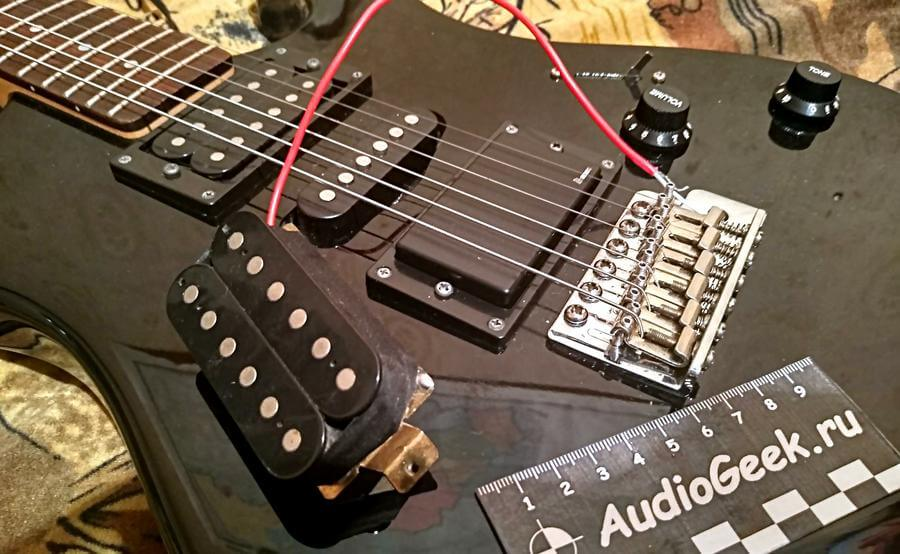

## Active or passive pickups

First of all, of course, you need to get the pickup itself. That is up to you. This article is about the replacement process itself.

If it is simply a matter of replacing a pickup with a similar, better one, there are not many problems. Replacing passive pickups with active ones can be much more complicated, because you also have to find a place for the battery.

If there is no such place, you will have to route the body and, besides the pickups themselves, find a compartment for the battery.

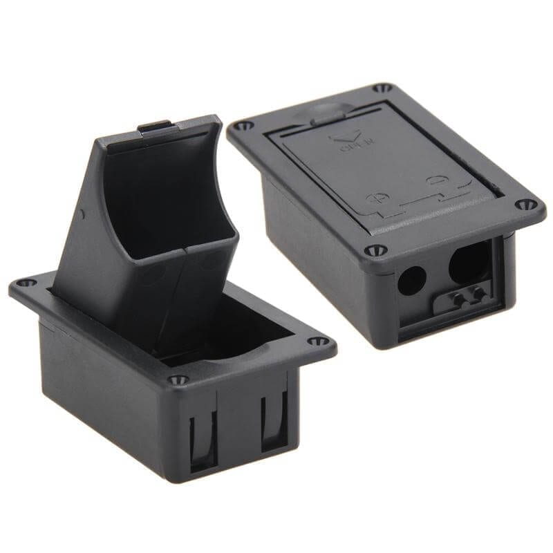

Often the battery can be hidden in one of the existing cavities. But even when replacing with non-active pickups, problems can also arise. But let us take everything in order.

## A new guitar pickup

This article came about because I came into a nice Ibanez pickup. A friend kindly shared it with me after replacing it with an active EMG pickup. My guitar is a Yamaha.

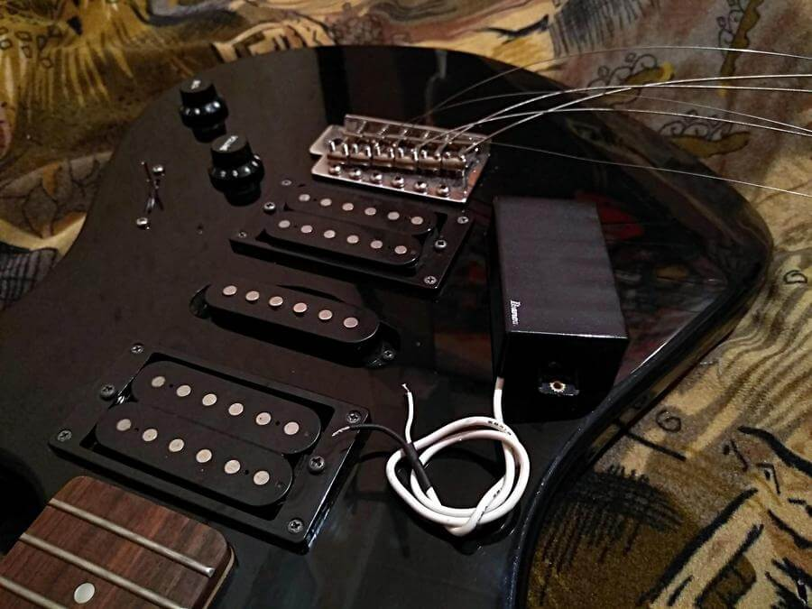

The pickup I got is a bridge humbucker. So we will install it in the bridge position, i.e. closer to the tailpiece.

### Measure seven times...

First it is desirable to take a look at the guitar's original pickup and the cavity cut for it. So we leave the strings dangling from the tailpiece and unscrew the original pickup.

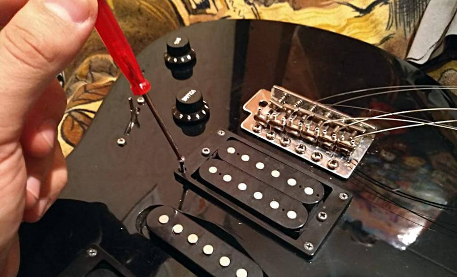

Pull it out on its wire and try the new pickup in the existing cavity. In principle most manufacturers keep to similar dimensions. In my case the new pickup fit almost perfectly, although it was somewhat wider than the original.

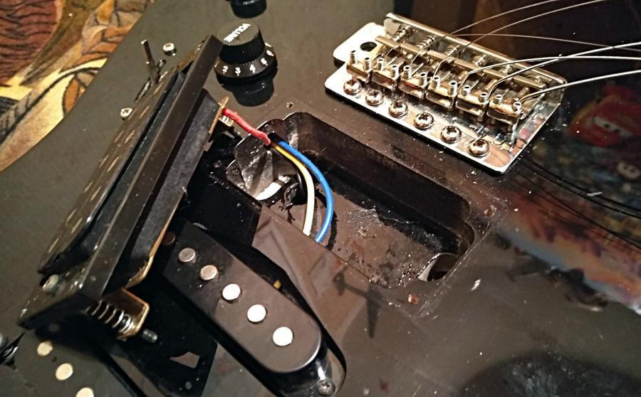

If the pickup does not simply fit into the guitar, you will have to enlarge the opening. You can do this yourself by hand, carefully removing the excess wood with a chisel. Or you can use a rotary tool.

***If you are not sure of your abilities, it is better to give the guitar to a professional for routing.***

## Mounting the guitar pickup

I got the pickup without mounting hardware, so I had to cross it with what I already had. The mountings of both pickups were built the same way. That clearly made my life easier.

The pickup is held to the mounting ring by two fairly long screws. These screws adjust the height at which the pickup protrudes.

The ring itself is screwed to the guitar body with wood screws. To keep the pickup from rattling, it is pushed up by two springs placed on the adjustment screws. This is the most common design. The distance between these screws matched perfectly.

## The wrong screws

The problem turned out to be that the screws from my guitar had a diameter of 3 mm, while the holes on the new pickup were 2.5 mm. Where do you get screws of that length in 2.5 mm?

Since there was a rehearsal tomorrow and the guitar was already taken apart, I decided not to bother looking for screws. I fetched something that can drill from the depths of the closet.

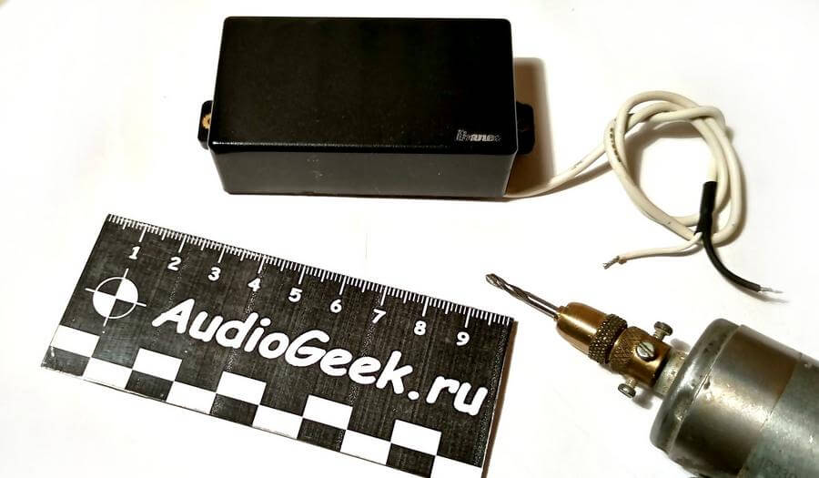

And with a 2.5 mm drill bit I drilled out the mounting holes.

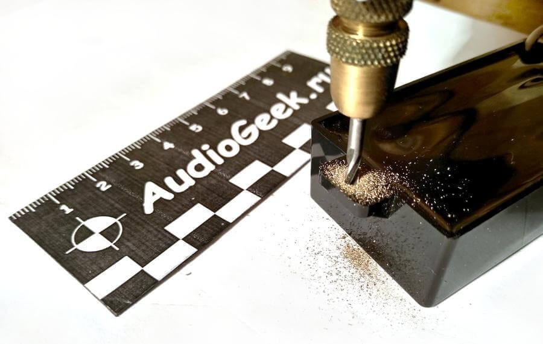

Now you can easily cut a 3 mm thread. It is good that the brass inserts melted into the plastic of the pickup body allowed this. Otherwise I would have had to secure the pickup with small nuts, and then I would have to unscrew the pickup every time to adjust it. Though that is usually done only once.

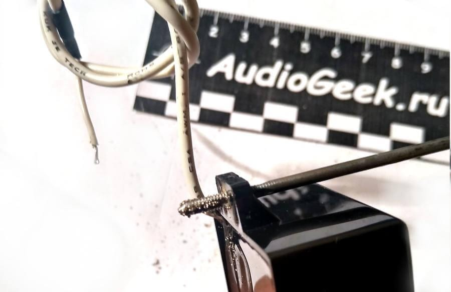

That was the end of crossing the two pickups. Assembled, it looks like this:

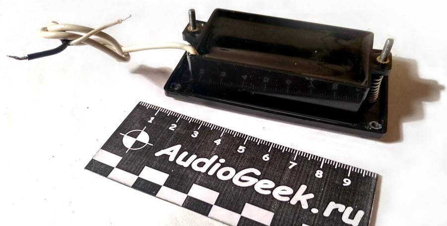

Great, the guitar pickup with all its mounting is ready; it remains to implant it into the guitar. To do that, unscrew the cover over the controls and switches. As on many modern guitars, on mine it is on the back.

Once you reach the wiring, work out where the wires of the original pickup go. Remember them and desolder them. Then, passing the wires of the new pickup through the hole, solder them in the same way as the old one.

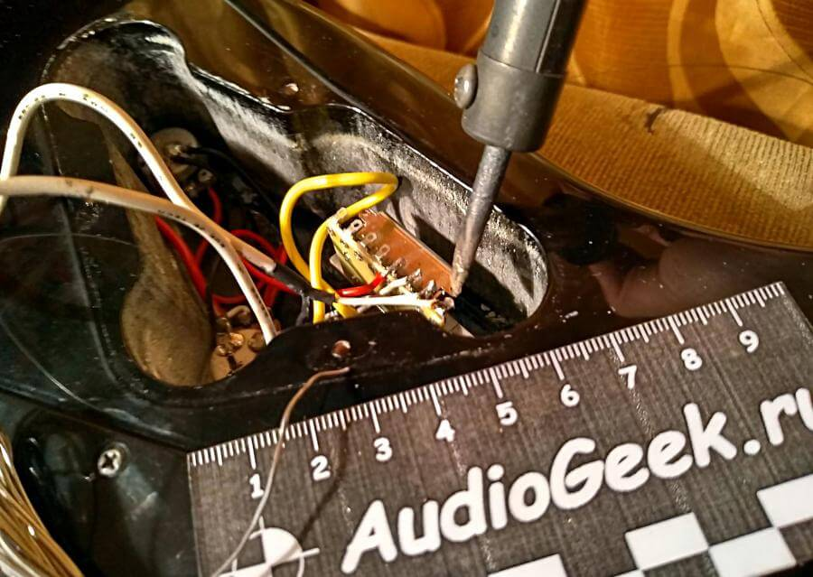

The wire colors may differ. In my case they are black and white. By common convention dark colors and shades mark the wires that go to ground (i.e. the negative), and bright ones are what goes to the switch (the positive, or "hot"). If the pickup wire is shielded, the shield is also soldered to ground.

After soldering, plug the guitar into an amplifier and tap the pickup with a metal object, for example a screwdriver. If you hear the tap through the amplifier, everything is OK. Now you can screw the new pickup into its place.

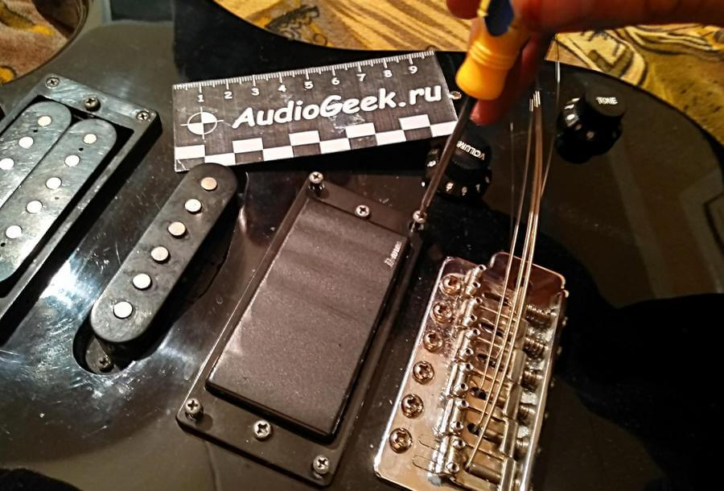

Tune up the strings and enjoy the new sound, turning the pedal knobs in all directions.

*Originally written for [AudioGeek.ru](https://audiogeek.ru). Translated from Russian.*
