[English](./README.md) | **Русский**

# Новый звукосниматель для гитары, как установить

**Дата:** 2018-11-01  
**Рубрики:** Уход и настройка гитары  
**Метки:** своими руками  
**Оригинал:** https://audiogeek.ru/zvukosnimatel-dlya-gitari/

---

Любой гитарист со временем задумывается об апгрейде любимой гитары. Наилучшим вариантом тут, наверное, можно назвать новый звукосниматель для гитары. Поговорим сегодня о том, как заменить звукосниматель на гитаре и какие подводные камни могут встретиться на пути.

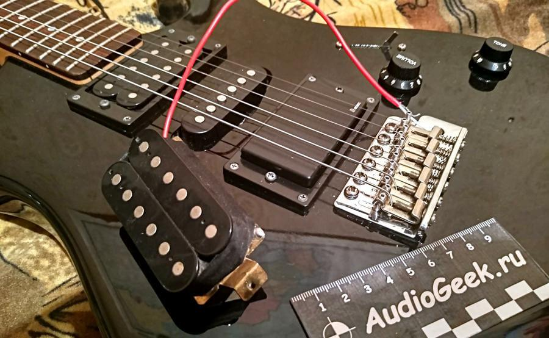

## Активные звукосниматели или пассивные

Первым делом, разумеется, необходимо раздобыть сам звукосниматель для гитары.Тут уже дело за Вами.  Данная статья о самом процессе замены.

Если речь идет просто о замене звукоснимателя на аналогичный более качественный, то тут проблем не так много. Гораздо сложнее может обернуться замена пассивных звуконимателей на активные. Т.к. Для них придется еще искать место для размещения батарейки.

Если такого места нет, то придется фрезеровать корпус и помимо самих звукоснимателей искать корпус для размещения батарейки.

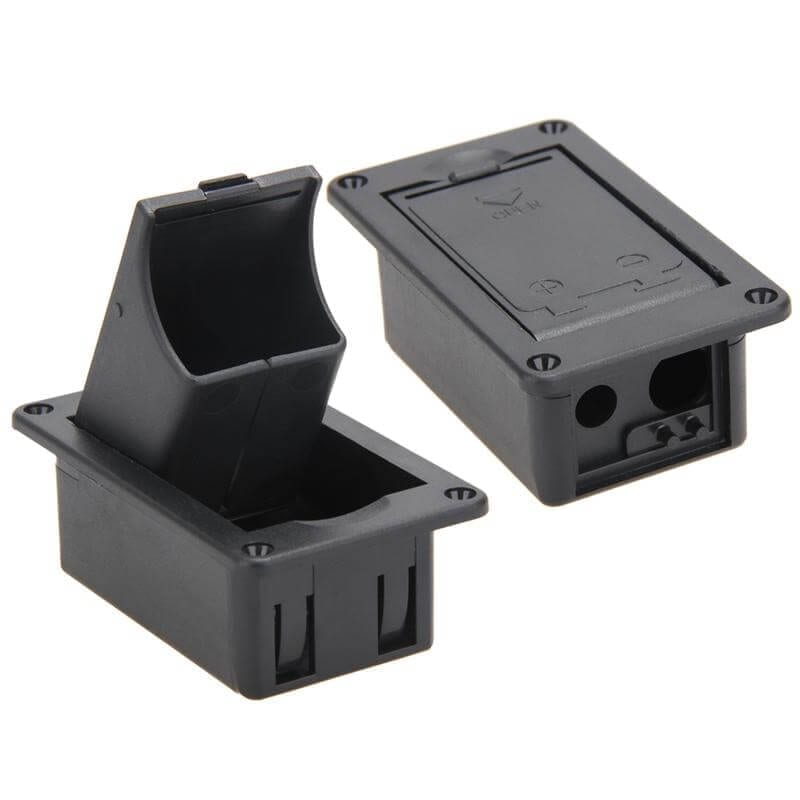

Часто батарейку удается спрятать в одно из уже имеющихся отверстий. Но и в случае замены не на активные звучки, так же могут возникнуть проблемы. Но обо всем по порядку.

## Новый звукосниматель для гитары

Данная статья возникла как результат того, что мне перепал хорошенький звукосниматель Ibanez. Им со мной любезно поделился друг, заменивший его активным звукоснимателем EMG. У меня же гитарка Yamaha.

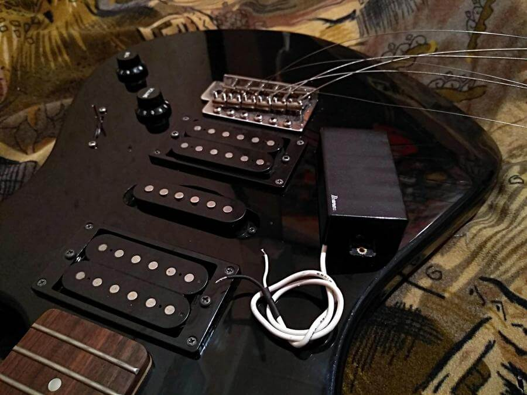

Доставшийся мне звукосниматель - бриджевый хамбэкер. Так что и ставить его будем в бридж, т.е. ближе к струнодержателю.

### 7 раз отмерь...

Первым делом желательно взглянуть на родной звукосниматель гитары и вырезанную под него дырку. Поэтому оставляем струны болтаться на струнодержателе и выкручиваем родной звукосниматель.

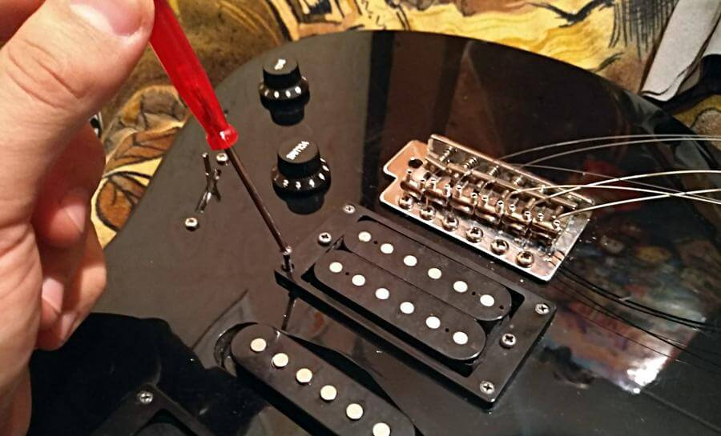

Вытягиваем его на проводе и примеряем новый звукосниматель в имеющееся в гитаре дупло.В принципе большинство производителей придерживаются близких размеров. В моем случае новый звукосниматель залез практически идеально, хотя и несколько шире родного.

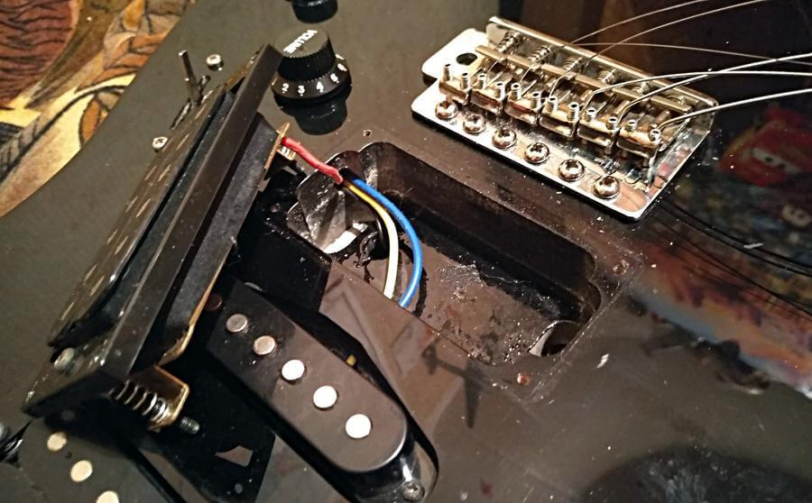

Если же звукосниматель не влез в гитару просто так, то потребуется увеличивать отверстие. Сделать это можно самостоятельно в ручную, аккуратно снимая стамеской лишнее дерево. Либо можно воспользоваться бор машинкой.

***Если вы не уверены в своих силах, то лучше отдать гитару на фрезеровку профессионалу.***

## Крепеж звукоснимателя для гитары

Мне звукосниматель перепал без крепежки, поэтому придется скрещивать с тем, что уже есть. Крепежи обоих звукоснимателей имели одинаковое устройство. Это явно облегчило мне жизнь.

Звукосниматель держится на передней панели на двух, довольно длинных, винтах. Этими винтами осуществляется регулировка высоты, на которую выступает звукосниматель. 

Панель же прикручивается саморезами к корпусу гитары. Для того чтобы звукосниматель не болтался он подпирается двумя пружинами, одетыми на регулировочные винты. Это самая распространенная конструкция. Расстояние между этими винтами совпало идеально.

## Не те винты

Проблема оказалась в том, что винты от моей гитары имели диаметр 3мм, а диаметр отверстий на новом звукоснимателе был 2.5мм. Где взять винты такой длины на 2.5 мм??

Так как завтра репетиция, а гитара уже раскручена, то с поиском винтов было решено не заморачиваться. Достаем из закромов шкафа что-то умеющее сверлить.

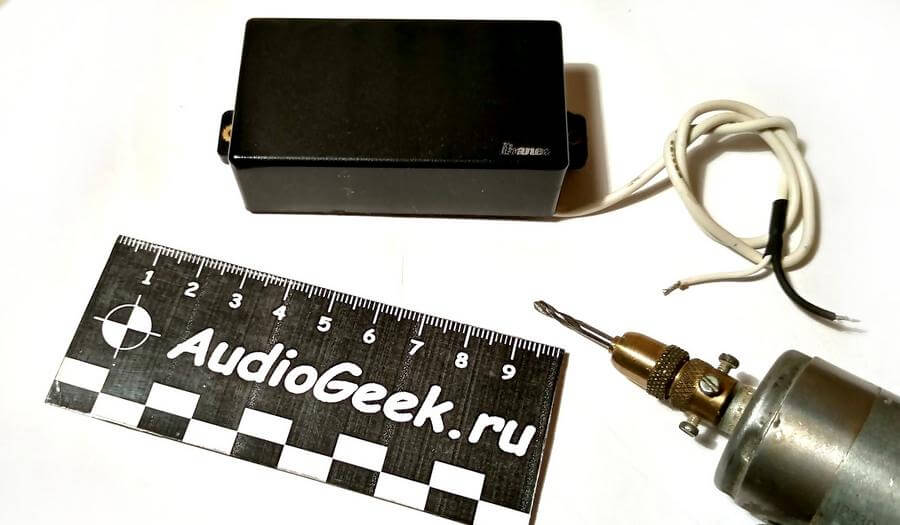

И сверлом на 2.5мм рассверливаем крепежные отверстия .

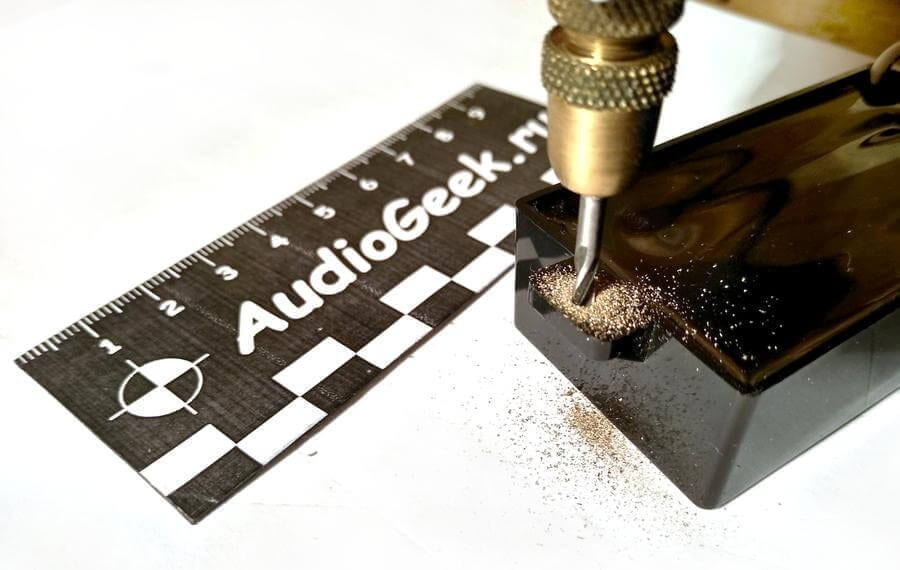

Теперь можно легко нарезать резьбу на 3мм. Хорошо, что это позволили латунные вставки, вплавленные в пластик корпуса звукоснимателя. Иначе пришлось бы подтягивать звукосниматель гаечками. Но тогда для регулировки придется каждый раз выкручивать звукосниматель. Хотя делается это как правило один раз.

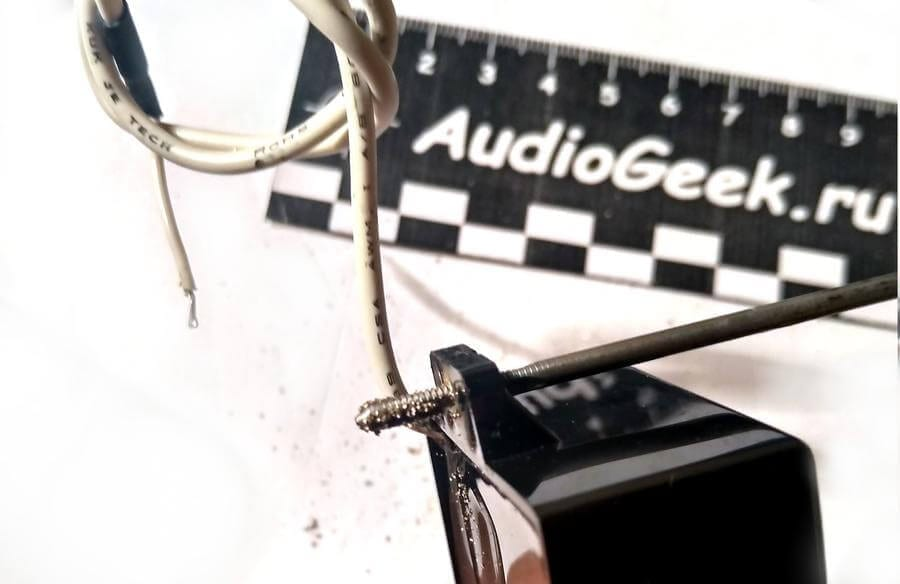

Собственно на этом скрещивание двух звукоснимателей было окончено. В собранном виде это выглядит следующим образом:

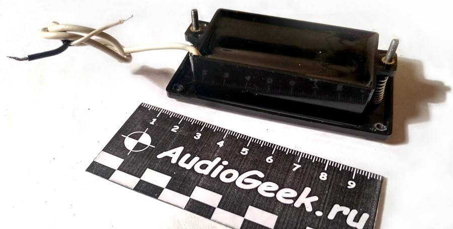

Отлично, звукосниматель для гитары со всей крепежкой готов, остается имплантировать его в гитару. Для этого откручиваем крышку, закрывающую регуляторы и переключателями. Как и у многих современных гитар, на моей она располагается с задней стороны.

Добравшись до проводки, определяемся, куда приходят провода родного звучка. Запоминаем и отпаиваем их. После чего, просунув провода нового звукоснимателя в отверстие, припаиваем их аналогично старому звучку.

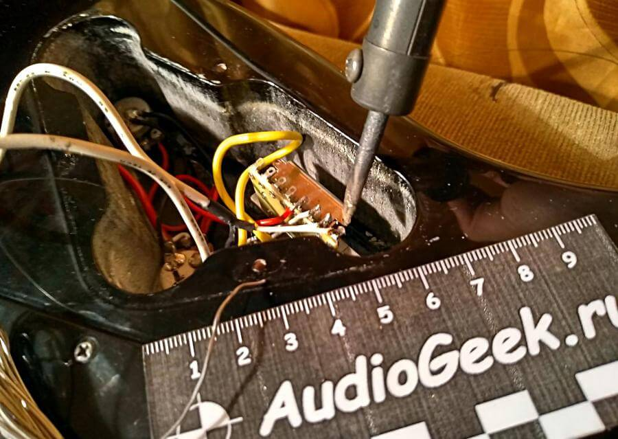

Расцветка проводов может быть различна. В моем случае это черный и белый. По общепринятым нормам темными цветами и оттенками обозначают провода идущие на землю (т.е.это минус), а яркими - то что пойдет на переключатель (плюс). Если провод звукоснимателя экранированный, то экран тоже припаивается к земле.

После припаивания втыкаем гитару в усилитель и стучим по звукоснимателю железным предметом. Например отверткой. Если услышали стук через усилитель. значит все ОК. Теперь можно вкрутить новый звукосниматель на отведенное ему место.

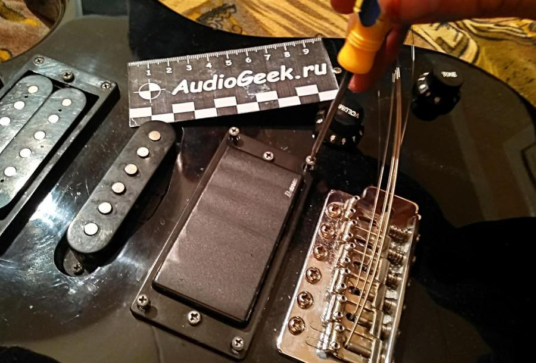

Натягиваем струны и радуемся новому звуку, крутя регуляторы примочек во все стороны.
